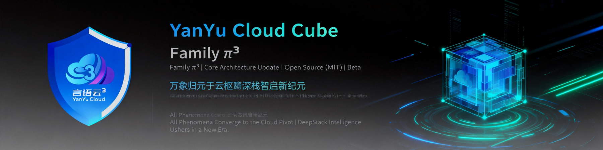
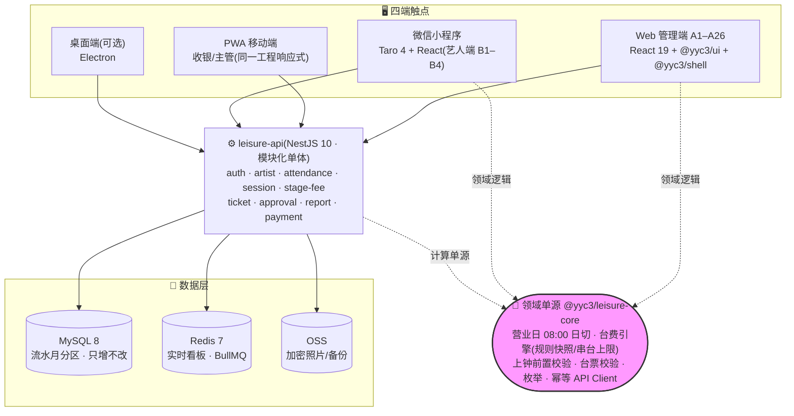

<div align="center">



# YYC³ LeisureManage

**独立运营的多门店艺人管理系统 · 四端一核 · 数据同步**

`KTV / 商务会所 / 夜总会` `艺人(技师)管理` `多门店 SaaS 化` `台费账户` `上下钟计费` `微信小程序艺人端`

<!-- ━━ ① 实时状态（GitHub Actions 直出 · push 自动刷新）━━ -->
[](https://github.com/YYC-Cube/YYC3-LeisureManage/actions/workflows/ci.yml)

<!-- ━━ ② 规划基线（docs 实证快照）━━ -->
[](docs/YYC3-LeisureManage-项目规划/YYC3-LeisureManage.md)
[](docs/YYC3-LeisureManage-项目规划/README.md)
[](https://github.com/YYC-Cube/YYC3-DeepStack-Matrix/tree/main/packages/leisure-core)
[](docs/YYC3-LeisureManage-项目规划/06-权限与安全设计.md)

<!-- ━━ ③ 技术栈 ━━ -->


<!-- ━━ ④ 工程与安全 ━━ -->


[](LICENSE)
[](https://github.com/YYC-Cube/YYC3-LeisureManage/pulls)

<!-- ━━ ⑤ 社区治理 ━━ -->
[](CODE_OF_CONDUCT.md)
[](CONTRIBUTING.md)
[](SECURITY.md)

</div>

---

> **Words Initiate Quadrants, Language Serves as Core for the Future**
> **万象归元于云枢 · 深栈智启新纪元**

**YYC³ LeisureManage** 是面向 **KTV / 商务会所 / 夜总会** 门店的**独立运营多门店艺人（技师）管理系统**：覆盖艺人档案、考勤报备、上下钟计费、台费账户、台票体系、订单预约、服务评价与财务对账全流程多端项目。

---

## 目录

1. [项目定位与铁律](#一项目定位与铁律)
2. [四端一核拓扑](#二四端一核拓扑)
3. [核心业务域](#三核心业务域)
4. [快速开始](#四快速开始)
5. [文档体系索引](#五文档体系索引)
6. [图文可视化体系](#六图文可视化体系)
7. [社区与贡献](#七社区与贡献)

---

## 一、项目定位与铁律

**独立运营**：自有门店/房型/订单/账务闭环，多门店 `store_id` 数据隔离、门店级参数配置（日切时刻/审批阈值/转移策略/计费规则），预留连锁总部视图；不做任何第三方 KTV 主系统集成。

**五条项目铁律**（违反即返工，全表见 [规划导览](docs/YYC3-LeisureManage-项目规划/README.md)）：

| # | 铁律 |
| --- | --- |
| 1 | **台费 = 艺人薪酬资金流**：充值/扣费双流水只增不改；冲正走 REVERSE 反向流水；手动扣费备注必填 + ≥阈值审批（审批人≠申请人） |
| 2 | **微信身份全局唯一**：一微信仅绑一店档案；跨店转移走人工工单（可配自动），全量留痕 `wechat_bind_log` |
| 3 | **营业日 08:00 日切**：全部流水/报表按 `business_date` 归集，服务端按门店日切时刻计算，客户端只预览 |
| 4 | **敏感个人信息合规**：身份证号 AES-256-GCM 加密、展示脱敏、访问留痕；照片 OSS 私有桶短时签名 URL |
| 5 | **危险操作二次确认**：资金/房态/删除类动作一律 confirm 弹窗，文案具体化（如「确认扣费 ¥200」） |

## 二、四端一核拓扑



> **领域单源铁律**：任何端**禁止复制实现**营业日/计费/前置校验/枚举，只能 `import '@yyc3/leisure-core'`（位于姊妹仓 [YYC3-DeepStack-Matrix](https://github.com/YYC-Cube/YYC3-DeepStack-Matrix) `packages/leisure-core`，tsc 严格模式通过 + vitest 用例在位）。

## 三、核心业务域

| 业务域 | 能力要点 |
| --- | --- |
| 档案与基础信息 | 94 字段档案/组别/等级/腰牌号店内唯一/批量设置/软删/注册二维码/自助绑定 |
| 考勤与报备 | 扫码签到签退(定位)/九类报备类型/明细+汇总矩阵/补打卡/实时状态色点看板 |
| 场次与台费 | 上钟选包厢房号/小时计费+进位阈值门店可配(默认15分钟)/规则快照/串台校验/手动扣费审批/流水三查 |
| 台票体系 | 票种规则/购买(现金·抖音)/核销抵扣/双流水/过期任务 |
| 订单·预约·评价 | 自有订单闭环/预约状态机/服务评价回收 |
| 多门店参数 | 艺人设置 8 项按店隔离:必填项/报备规则/签退时限/计费规则/上钟模式 |
| 报表中心 | 10 张报表对齐行业清单,统一营业日口径 + 包厢维度,导出/打印 |

## 四、快速开始

> 本仓库当前为**规划文档库**（设计已冻结,工程六阶段落位中）。克隆浏览文档：

```bash
git clone https://github.com/YYC-Cube/YYC3-LeisureManage.git
cd YYC3-LeisureManage
open docs/YYC3-LeisureManage-项目规划/README.md   # 从导览进入 00 需求全集 + 01–11 工程规划

bash scripts/verify-docs.sh                       # 本地文档门禁(对齐 CI)
```

**工程落位**（代码在姊妹仓 DeepStack-Matrix,六阶段执行详见 [PROMPT](docs/YYC3-LeisureManage-项目规划/PROMPT-新会话-全栈开发落地.md)）：

| 阶段 | 交付 | 门禁 |
| --- | --- | --- |
| 1 后端骨架 | NestJS+Prisma+seed / auth·artist·attendance | e2e 绿 |
| 2 场次与资金 | 上下钟两段式事务 / 审批 / 日切 job | 核心链路演示脚本全绿 |
| 3 Web 管理端 | A1–A19 页面 + shell 壳层 | 页面走查 · ui 组件占比≥80% |
| 4 PWA | manifest + BottomNav + 报备现场屏 | Lighthouse PWA ≥90 |
| 5 艺人小程序 | B1 注册绑定 / B2 扫码签到签退 / B4 我的流水 | 真机三链路通 |
| 6 报表+联调 | 7 张 MVP 报表 + ★ 用例自动化 | 覆盖 ≥90% |

## 五、文档体系索引

| 文档 | 内容 |
| --- | --- |
| [📄 完整需求文档 V3.0](docs/YYC3-LeisureManage-项目规划/YYC3-LeisureManage.md) | **需求全集**：28 项菜单/八大业务域/包厢房号管理/小时计费+可配置进位阈值(门店自定义,默认15分钟)/艺人设置8项/移动端四Tab/同赛道开源对标 |
| [🗺️ 项目规划导览](docs/YYC3-LeisureManage-项目规划/README.md) | 00–11 + PROMPT 全套导览、独立运营定位、项目铁律 |
| [🏗️ 工程规划 01–11](docs/YYC3-LeisureManage-项目规划/README.md#文档导览) | PRD / 架构 / 库表 / API / 页面 26+4 / 权限安全 / 计划 / 测试 / 技术栈 / 后端 / 数据库 |
| [⭐ PROMPT 全栈落地](docs/YYC3-LeisureManage-项目规划/PROMPT-新会话-全栈开发落地.md) | 新建开发会话提示词：六阶段顺序·铁律·环境注意事项·阶段门禁 |
| [🎨 可视化交互体系设计](docs/YYC3-LeisureManage-可视化交互体系设计.md) | 品牌视觉资产/徽章体系/Mermaid 图集/四端交互规范/文档视觉治理 |
| [📐 团队标规随仓副本](docs/YYC3-团队通用-标准规范/) | 开发文档/标规文档/验收体系参照(修订以团队真身为准) |

## 六、图文可视化体系

本仓库的可视化语言（顶图/徽章/架构图/交互规范）统一由 [《可视化交互体系设计》](docs/YYC3-LeisureManage-可视化交互体系设计.md) 治理：品牌四行署名块、shields 五行徽章位、Mermaid 架构图集（四端拓扑/业务闭环/计费流程/艺人状态机）、以及资金红线类页面的交互规范（负数红字/危险确认弹窗/色点看板）。

## 七、社区与贡献

- 🤝 贡献流程与文档修订规则：[CONTRIBUTING.md](CONTRIBUTING.md)
- 📜 行为准则：[CODE_OF_CONDUCT.md](CODE_OF_CONDUCT.md)
- 🔐 漏洞报告（请勿公开 Issue）：<security@0379.email>，详见 [SECURITY.md](SECURITY.md)
- 💬 一般协作：[GitHub Issues](https://github.com/YYC-Cube/YYC3-LeisureManage/issues)

---

<div align="center">

> ***YanYuCloudCube***
> *言启象限 | 语枢未来*
> ***Words Initiate Quadrants, Language Serves as Core for Future***
> *万象归元于云枢 | 深栈智启新纪元*

**© 2025-2026 YanYuCloudCube™. All Rights Reserved.**

</div>
