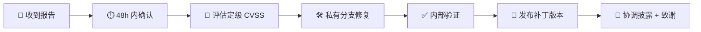

# 安全政策（SECURITY）

> ***YanYuCloudCube*** · *言启象限 | 语枢未来*
> 感谢你帮助守护 YYC³ 家族项目的安全。

---

## 支持的版本

| 版本 | 支持状态 |
| ---- | -------- |
| 最新 `main` 线 / 最新 Release | ✅ 积极维护，接收安全修复 |
| 前一个 minor 版本（N-1） | ⚠️ 仅严重漏洞 |
| 更早版本 | ❌ 不再支持，请升级 |

---

## 报告漏洞

**请勿通过公开 Issue、Discussion、PR 或社交媒体披露漏洞细节。**

推荐渠道（按优先序）：

1. **GitHub 私密漏洞报告**：项目仓库 `Security` → `Report a vulnerability`
2. **邮件**：<security@0379.email>（抄送 <admin@0379.email>，主题含 `[SECURITY] YYC3-LeisureManage`）

报告请尽量包含：

- 受影响版本 / 模块 / 提交 SHA
- 复现步骤或最小 PoC（可脱敏）
- 影响评估（泄露 / 提权 / 拒绝服务 / 供应链）
- 可公开时间偏好

> ⚠️ 请勿附带真实密钥、生产数据或他人隐私；使用 `${ENV_VAR}` 或 `[REDACTED]` 占位。

---

## 响应流程与时限（SLA）

| 阶段 | 目标时限 |
| ---- | -------- |
| 确认收到 | ≤ 48 小时 |
| 初步评估定级 | ≤ 7 天 |
| 高危（High+）修复 | ≤ 30 天 |
| 公开披露 | 补丁发布后 90 天内协调公开 |

遵循**协调披露**：修复可用前不公开可利用细节；经同意致谢报告者。

---

## 严重度处理（CVSS）

| CVSS | 处置 |
| ---- | ---- |
| 9.0–10.0 Critical | 立即应急：冻结发布窗 + 热修 + 全员通告 |
| 7.0–8.9 High | 30 天内补丁，自动建 Issue 指派安全负责人 |
| 4.0–6.9 Medium | 下一例行版本 |
| 0.1–3.9 Low | 积压清单 |

---

## 团队安全基线（通用）

1. **密钥与凭证**：仅经环境变量或 Vault 注入，仓库内零硬编码；`.env` 不入库，参考 `.env.example` 创建
2. **敏感占位**：文档、日志、提示词中出现敏感值一律 `${ENV_VAR}` 或 `[REDACTED]`
3. **最小暴露**：服务端点默认绑定回环地址；跨机访问必须启用鉴权（Bearer Token 等），禁止未鉴权暴露公网
4. **供应链**：依赖锁定（lockfile）；新增依赖需说明必要性并接受额外评审；不在脚本中动态拉取远程代码执行
5. **门禁诚实**：回归/安全门禁失败必须如实上报（失败不伪装通过）；门禁产物不可伪造后提交
6. **审计可验**：审计/日志链可检测篡改，关键链路建议哈希链 + 外部存储

---

## 项目安全基线（YYC3-LeisureManage 增补）

本系统管理**销售经理薪酬资金流**与**敏感个人信息**，以下为项目特有安全面（工程规格见 `docs/YYC3-LeisureManage-项目规划/06-权限与安全设计.md`）：

1. **资金流水不可变**：台费/台票流水表（`stage_fee_txn` / `ticket_txn`）与审计表对应用数据库账号 **REVOKE UPDATE/DELETE**；任何更正只能以 REVERSE 反向流水记账并关联原单。**不接受**任何"直接改流水"类需求或补丁
2. **手动扣费双人防线**：备注必填；单笔 ≥ 阈值（默认 ¥500，门店级可配）必须走审批单，且**审批人与申请人不得同一人**
3. **敏感个人信息（个保法）**：身份证号 AES-256-GCM 加密存储（KMS 托管密钥）、展示脱敏（前3后4）；身份证照/人像照 OSS 私有桶 + 短时签名 URL（≤5 分钟）；解密与查看动作全程审计。测试数据**一律合成**，严禁使用真实个人信息
4. **写接口幂等**：资金/单据写接口强制 `Idempotency-Key`（24h 去重）；支付渠道回调以渠道单号唯一约束兜底，重复回调不重复落账
5. **营业日口径统一**：`business_date` 一律由服务端按门店日切时刻（默认 08:00）计算并冗余存储；客户端提交的营业日字段不可信。涉及此口径的变更需附双口径单测
6. **越权防护**：所有 `/{id}` 接口校验资源属主（门店/组数据范围）；水平越权用例纳入回归（08 号文档 S-02）
7. **第三方商业系统隔离红线**：本系统**完全独立运营**；需求考察所参照的第三方商业系统仍在真实营业，**严禁**任何触碰其数据、界面或接口的开发/测试行为
8. **审计链**：`audit_log` 追加写（独立账号仅 INSERT），月度归档哈希链防篡改；敏感操作（资金/档案/规则/导出）全覆盖

---

## 不在范围内

- 依赖包自身漏洞（请同时反馈上游）
- 社会工程、物理安全、非本项目部署环境的问题
- 未授权渗透或对生产环境的破坏性测试

---

## 安全测试约定

- 仅在你**拥有或获授权**的环境测试
- 不得造成数据破坏、服务中断或隐私侵犯
- 遵守 [行为准则](CODE_OF_CONDUCT.md)
- 善意研究在遵守上述约定前提下，我们不会采取法律行动

---

## 联系方式

| 用途 | 渠道 |
| ---- | ---- |
| 漏洞报告 | <security@0379.email> / GitHub Security Advisories |
| 一般安全问题 | <admin@0379.email> |
| 行为准则事件 | <admin@0379.email> |

> 「***YanYuCloudCube***」 · **© 2025-2026 YanYuCloudCube™. All Rights Reserved.**
