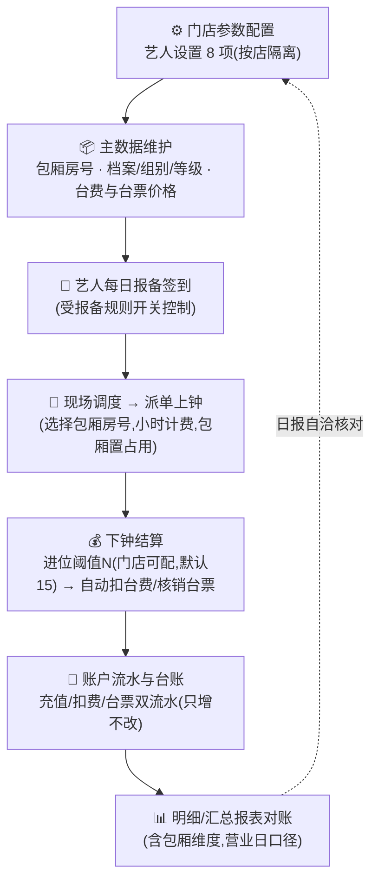
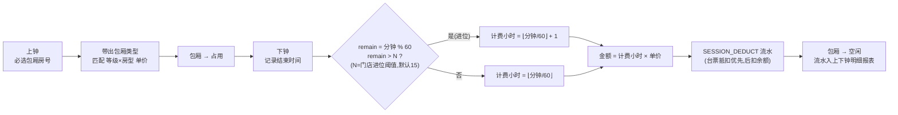
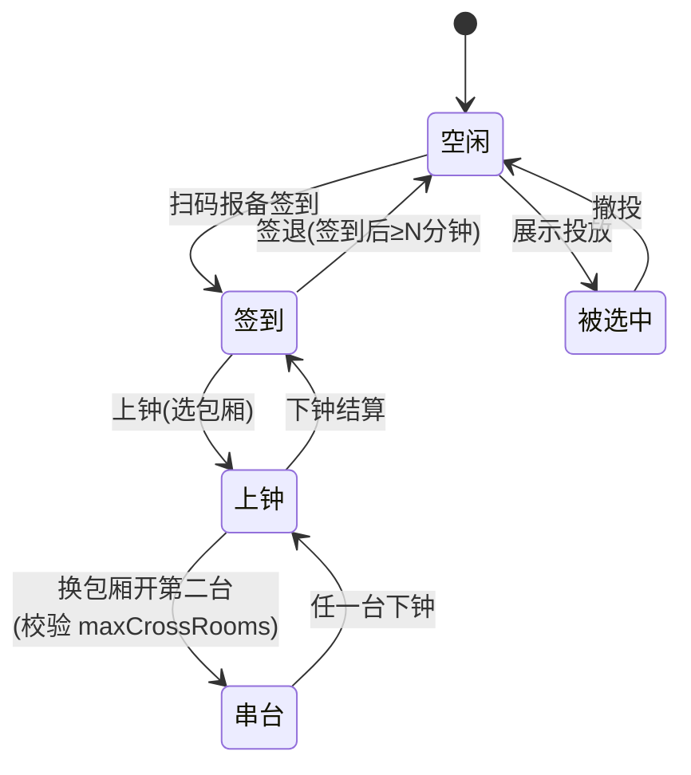

<div align="center">

> ***YanYuCloudCube***
> *言启象限 | 语枢未来*
> ***Words Initiate Quadrants, Language Serves as Core for Future***
> *万象归元于云枢 | 深栈智启新纪元*

</div>

---

# 🎨 YYC3-LeisureManage · 可视化交互体系设计

> **治理原则：一处定义，四端引用**——本文档是本仓库所有可视化元素（顶图/徽章/架构图/交互范式）的单一事实源；与团队标规《YYC3-架构体系-可视化设计》同构，品牌资产以《YYC3-团队通用-文化标识》为准。

---

## 一、品牌视觉资产

### 1.1 文档顶图

| 项 | 规范 |
| --- | --- |
| 路径 | `public/yyc3-family.png`（全仓库唯一顶图,不复制多份） |
| 引用 | README 与主文档使用 `` 居中引用 |
| 禁止 | 文档内使用外链图片作为顶图;禁止裁剪/改色 |

### 1.2 品牌四行署名块（文档首尾标准件）

```markdown
> ***YanYuCloudCube***
> *言启象限 | 语枢未来*
> ***Words Initiate Quadrants, Language Serves as Core for Future***
> *万象归元于云枢 | 深栈智启新纪元*
```

- 主文档首部用 `<div align="center">` 包裹版本;文末用引用块版本
- 版权行：`© 2025-2026 YanYuCloudCube™. All Rights Reserved.`
- 联系渠道统一 `admin@0379.email`（安全事件 `security@0379.email`）

### 1.3 项目标语（LeisureManage 专属）

**「独立运营的多门店艺人管理系统 · 四端一核 · 流水不可变 · 营业日 08:00 日切」**——用于 README 副标题与对外介绍首行。

---

## 二、徽章体系（README 五行徽章位）

徽章按五行分区排布于顶图之下,顺序固定;中文 label 需 URL 编码（shields.io）:

| 行 | 定位 | 本仓库徽章 |
| --- | --- | --- |
| ① 实时状态 | GitHub Actions 直出,push 自动刷新 | `CI 文档门禁`(workflows/ci.yml) |
| ② 规划基线 | 静态实证快照,变更时同步更新 | `需求全集 V3.0` · `工程规划 01–11` · `领域单源 leisure-core` · `资金红线 只增不改` |
| ③ 技术栈 | logo 官方色 | React 19 · TypeScript strict · Taro 4 · NestJS 10 · Prisma · MySQL 8 · Redis 7 |
| ④ 工程与安全 | 工程约束 | Node ≥22 · pnpm workspace · Vitest · License MIT · PRs Welcome |
| ⑤ 社区治理 | 四件套入口 | Contributor Covenant v2.1 · 贡献指南 · 安全政策 |

> 工程阶段推进后,②区快照徽章随之升级（如「门禁 e2e 绿」「A1–A19 走查通过」）,禁止移除 ①⑤区。

---

## 三、Mermaid 图集（架构叙事标准图）

以下四图为本项目架构叙事的**标准图元**,文档引用时直接复用,不得另行绘制同义异构图。

### 3.1 四端一核拓扑（仓库级,见根 README §二）

领域单源包 `@yyc3/leisure-core` 居中承接四端;数据层 MySQL(流水月分区)/Redis(看板)/OSS(加密照片)。

### 3.2 业务闭环



### 3.3 上下钟计费流程（小时计费 + 可配置进位阈值 N）



> 规则快照铁律:计费单价与**进位阈值 N** 均取**上钟起表时点**的快照;当日已有该房型上钟时禁改规则(40903)。进位阈值 N 为**门店级自定义参数**(默认 15 分钟,管理端可编辑为任意分钟)。

### 3.4 艺人实时状态机（色点看板）



**状态色点色值**（实现期映射 @yyc3/theme 令牌,以下为设计基线）:

| 状态 | 状态码 | 色值 | 语义 |
| --- | --- | --- | --- |
| 空闲 | 0 | `#10B981` emerald-500 | 可派单 |
| 签到 | 1 | `#0EA5E9` sky-500 | 在岗未上台 |
| 上钟 | 2 | `#F59E0B` amber-500 | 服务中 |
| 串台 | 3 | `#8B5CF6` violet-500 | 多台并行 |
| 被选中 | 4 | `#F43F5E` rose-500 | 展示投放中 |

---

## 四、四端交互规范（资金红线类）

### 4.1 全局交互六则（源自页面规格 C 章,四端一致）

1. **危险确认**:资金/房态/删除类操作一律 confirm 弹窗,红色主按钮**文案具体化**（「确认扣费 ¥200」而非「确定」）
2. **金额展示**:负数红色（负余额=未收款语义）;金额一律 2 位小数
3. **空态**:统一插画 +「暂无××记录」文案
4. **搜索**:腰牌号/艺名双字段合一模糊搜索
5. **打印**:小票模板(交接单风格)+ A4 导出双通道
6. **时间**:展示到分钟;营业日跨天显示「11-01 02:00」实际归集 10-31 营业日

### 4.2 色彩语义红线

- **红**仅用于:负金额、危险操作按钮、异常状态（定位不可用/审批驳回）——不得作装饰色
- **状态色点**只用于实时看板/卡片墙,列表内用文字标签,避免色彩噪声
- 主题令牌以 `@yyc3/theme` 为单源（小程序端 NutUI 变量覆盖同源映射）

---

## 五、文档视觉治理

| 项 | 规则 | 门禁 |
| --- | --- | --- |
| Front Matter | `docs/**.md` 必填 `file/description/version/created/status` | CI 检查 |
| 顶图引用 | 仅根 README 与主文档引用 `public/yyc3-family.png` | CI 死链检查 |
| 四行署名块 | 主文档首尾必备 | CI 抽检 |
| 修订头模式 | 裁决/口径变更 = 头部追加 `vN.N(日期 裁决修订)` 行 + 段落精准替换,历史行保留 | PR 评审 |
| 链接 | 全部相对链接,无外链依赖（GitHub 仓库链接除外） | CI 检查 |
| 敏感信息 | `${ENV_VAR}` / `[REDACTED]` 占位;严禁真实个人信息/密钥 | CI + 评审 |

> 门禁脚本:`scripts/verify-docs.sh`（本地）与 `.github/workflows/ci.yml`（CI）同源执行。

---

## 版本记录

| 版本 | 日期 | 变更 |
| --- | --- | --- |
| v1.0.0 | 2026-11-01 | 首版:品牌资产/徽章体系/Mermaid 四图/交互规范/视觉治理 |

---

> ***YanYuCloudCube***
> *言启象限 | 语枢未来*
> *Words Initiate Quadrants, Language Serves as Core for Future*
> *万象归元于云枢 | 深栈智启新纪元*
