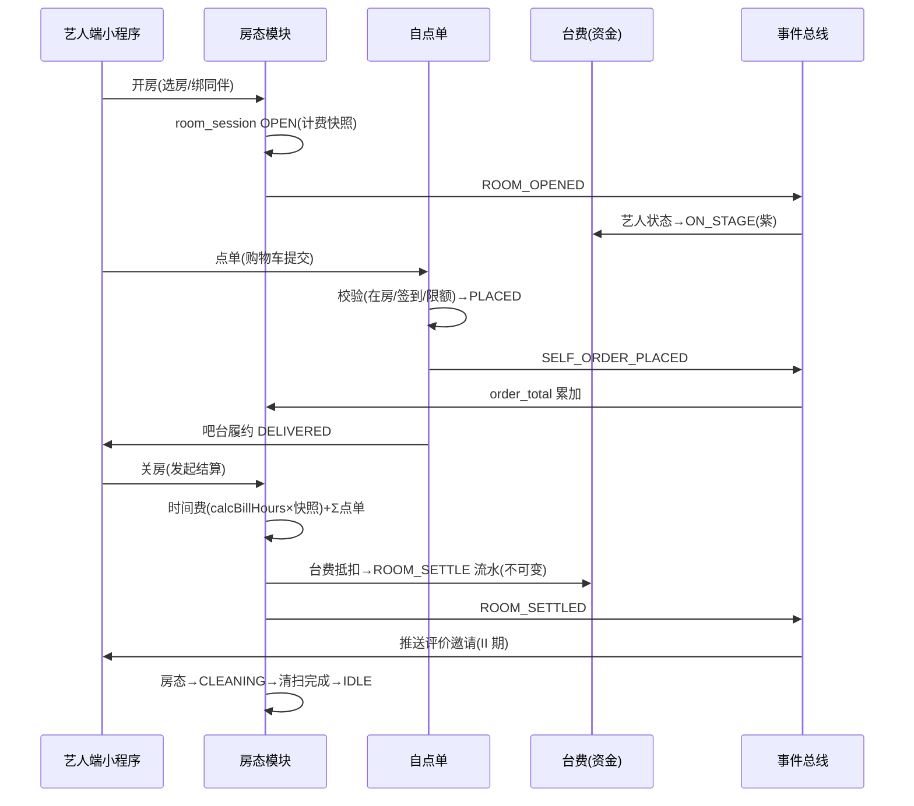

# 艺人模块融合与数据互通 · 设计指导

> 版本:v1.0(2026-11-01)|上游:艺人管理 25 子模块实测(05 号规格书)· 房态/自点单两份构建指导
> 回答两个问题:①艺人管理模块里**哪些内容进入包厢房态/操作模块、以什么方式**;②两模块之间**数据怎样互通**才不破坏「领域单源 + 流水不可变 + 营业日统一」三条底线

---

## 一、融合矩阵:艺人管理 25 子模块 → 包厢模块承接方式

| 艺人子模块 | 承接方式 | 融合点(包厢模块侧) |
|---|---|---|
| **艺人上下钟** | 直接融合(同实体) | 房内场次即上钟:开房绑艺人 ⇄ show_session 关联 room_session;实时状态→ON_STAGE;下钟计费走第六章 `calcBillHours` |
| **艺人实时状态** | 直接融合 | 看板双视角同源:艺人看板(色点:空闲/签到/上钟/串台/被选中)⇄ 房态看板(四色);数据源同一批 session/report |
| **艺人台费设置** | 规则联动 | 房内点单与房费结算的资金来源;`unit_price` 快照随「等级×房型」规则带出 |
| **台费充值/扣费/手动扣费** | 资金联动 | 关房结算 `FEE_DEDUCT` → ROOM_SETTLE 流水(新类型);余额=Σ流水 口径不变 |
| **台票(设置/购买/使用)** | 抵扣联动 | 时间费可用台票抵扣(第六章 6.6):核销 USE 流水后再扣台费余额 |
| **艺人订单** | 镜像融合 | 艺人自点单 → `artist_order` 镜像(orderType=自点单),艺人端「我的订单」统一视图 |
| **艺人服务评价** | 触发融合 | 关房结算后向房内艺人推送评价邀请(评包厢+互评),写入 artist_review |
| **艺人报备(签到/签退)** | 门槛联动 | 点单/开房前置校验:当日已报备;报备本身保持独立流程(不自动签到) |
| **艺人预约管理** | II 期联动 | 预约单 → 到店后转开房(booking.room 预绑) |
| **艺人展示控制台** | II 期联动 | 投放中的艺人所在房在房卡上标「展示位」 |
| 组别/等级/注册绑定/补打卡/报备汇总/台费设置本身 | 不进房模块 | 仍是艺人模块本体;房模块只读引用 |

> 一句话:**「人、钱、单」三个维度融合(上下钟/台费/订单),「档案与规则」不搬家(仍归艺人模块)**。

---

## 二、数据互通设计

### 2.1 三条底线(互通的前提,违反即故障)

1. **领域单源**:营业日/计费/校验只 import `@yyc3/leisure-core`;互通事件 payload 中的业务值由生产方用单源函数计算,消费方不得重算
2. **流水不可变**:跨模块资金联动只产生新流水(ROOM_SETTLE),绝不 UPDATE 对方模块的数据
3. **营业日统一**:所有事件与冗余字段携带 `businessDate`(由生产方按门店日切计算)

### 2.2 事件驱动(进程内事件总线起步;连锁期换 MQ)

| 事件 | 生产方 | 消费方与联动动作 |
|---|---|---|
| ROOM_OPENED | 房态模块 | 考勤/艺人模块:绑定艺人实时状态→ON_STAGE;报表:当日开房数+1 |
| ARTIST_JOINED_ROOM / LEFT_ROOM | 房态模块 | 艺人模块:room_session_artist 流水;看板双视角刷新 |
| SELF_ORDER_PLACED | 自点单 | 房态:order_total 累加;订单镜像:artist_order 插入;艺人端:通知「已下单」 |
| SELF_ORDER_DELIVERED | 吧台履约 | 艺人端通知「已送达」 |
| ROOM_SETTLED | 房态(关房) | 台费:ROOM_SETTLE 流水(每艺人按抵扣分配);订单:封单;评价:推送邀请;报表:日收益/未收款刷新 |
| ROOM_CLEANING_DONE | 房态 | 看板刷新 |

实现:先进程内 `EventEmitter2`(NestJS 内置,同事务/异步皆可);字段落 `integration_event` 表兜底重放——**表已建**(11 号文档),沿用即可。

### 2.3 实时状态扩展(色点语义)

实测五色点(空闲/签到/上钟/串台/被选中)在本系统语义落位:

| 色点 | 触发 | 数据源 |
|---|---|---|
| 签到 | 报备 CHECKIN | attendance_report |
| 上钟(紫) | ∈ room_session.artistIds 且 session OPEN | room_session_artist(在房即上钟,对齐「房内即消费」简化语义) |
| 串台(粉) | 同一艺人同时 ∈ 多个 OPEN session | room_session_artist 联查(count>1) |
| 被选中(橙) | showcase_cast 投放中(II 期) | showcase_cast |
| 空闲 | 已签到但不在任何房 / 未签到 | 兜底 |

> 与实测差异说明:实测「上钟」由艺人主管操作台/收银发起;本系统**进房即上钟**(艺人自助开房/进房),色点语义不变、触发简化——这正是「艺人自己点单/自己开房」差异化能力的状态面体现。

### 2.4 统一读模型(看板双视角不重复计算)

- `daily_summary.metrics` 增 `room: { openCount, roomFee, orderTotal, unsettled }` 与 `artist: { checkedIn, onStage, cross }`
- 由日切任务物化 + 实时看板走 Redis(骨架期 DB 查询兜底)

---

## 三、leisure-core 增补清单(实现同步;单源纪律)

| 项 | 内容 |
|---|---|
| types | `RoomSession`(房账,含计费快照/artistIds/orderTotal)/ `RoomSessionArtist`(进出流水)/ `SelfOrder` / `RoomStatus`(IDLE/OPEN/CLEANING/MAINTENANCE/DISABLED) |
| FeeTxnType | 增 `'ROOM_SETTLE'`(房账结算台费抵扣;与 MANUAL_DEDUCT 区分便于报表分列) |
| 错误码建议 | `ROOM_NOT_OPEN 40908` · `NOT_IN_ROOM 40909` · `ORDER_LIMIT_EXCEEDED 40910`(落 ERR 单源;与 04 文档错误码表同步) |
| 计算函数 | 房时间费**复用** `calcBillHours`(不新建);新增 `sumSessionOrderTotal(orders)` 纯聚合 |
| api-client | `rooms` / `roomSessions` / `selfOrders` 三个域方法组(对齐两份构建指导 §API) |

---

## 四、端到端时序(单包厢完整闭环)

---

## 五、验收要点(互通专项)

| # | 用例 | 预期 |
|---|---|---|
| X-01 | 开房联动状态 | 绑定艺人实时状态即时变 ON_STAGE;艺人看板与房态看板数字一致 |
| X-02 | 点单联动房账 | PLACED 后房卡「当前消费」立即含该单;艺人端我的流水(关房后)可见 ROOM_SETTLE |
| X-03 | 串台多房 | 同艺人两房同时在场:两房卡均显示;艺人状态=串台(粉) |
| X-04 | 台费抵扣分摊 | 多艺人各自分配抵扣额;每人 ROOM_SETTLE 流水各自正确;Σ流水=总额 |
| X-05 | 营业日跨界 | 23:00 开房、次日 01:00 关房:room_session 与全部流水 business_date=开房日(08:00 切) |
| X-06 | 事件重放 | integration_event 重放不产生重复流水(ref 幂等) |
| X-07 | 单源守卫 | 全库 grep 不存在绕过 leisure-core 的营业日/计费实现 |
