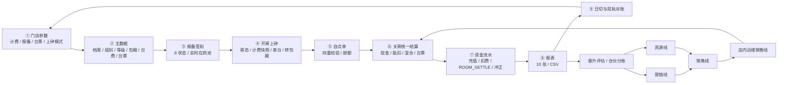

# 销售管理系统 · 模块协同标规与 AI 编程基线

> ✅ **深度审核标注（2026-11-04，审核人：YYC³ 工程会话）——已全部处置(见《专项落地方案规划》;N5 增补见 §八)**：
> N1 引用断链已修(需求全集/开发文档/标规目录路径,§附录 D 同步)· N2-N4 状态已回写(报表 10/10+xlsx/P1 口径/P0 完成)· N5 已增补(§八:STAFF/NOTICE/RESOURCE/FINANCE-SPLIT 系列 ID)· N6 WS-01 关单(2026-11-01 伪代码口径裁决;边界 10 用例钉死)· N7 WS-06 关单(env MANUAL_DEDUCT_THRESHOLD=500)· N8 SSOT 治理声明已补(§文档说明)· N9 §2.4 已标「取证规划未实现」· **WS-02 按「当前实现以《模块组成》为准」定案升已定** · **status: review → stable**
> 遗留:《模块组成》原件如后续找回,以附录 B 差异摘录比对增补。

> **_YYC³_**（YanYuCloudCube™ · 注册商标）
> _言启象限 | 语枢未来_
> **_Words Initiate Quadrants, Language Serves as Core for Future_**
> _万象归元于云枢 | 深栈智启新纪元_
> **_All things converge in cloud pivot; Deep stacks ignite a new era of intelligence_**

---

## 核心理念

**五高架构**：高可用 | 高性能 | 高安全 | 高扩展 | 高智能
**五标体系**：标准化 | 规范化 | 自动化 | 可视化 | 智能化
**五化转型**：流程化 | 数字化 | 生态化 | 工具化 | 服务化
**五维评估**：时间维 | 空间维 | 属性维 | 事件维 | 关联维

---

## 📋 目录

- [文档说明](#文档说明)
- [一、系统全景与边界](#一系统全景与边界)
- [二、模块单一事实源](#二模块单一事实源)
- [三、Web 模块详细规格](#三web-模块详细规格)
- [四、业务规则与数据契约](#四业务规则与数据契约)
- [五、实现状态与缺口](#五实现状态与缺口)
- [六、AI 协同编程规范](#六ai-协同编程规范)
- [七、冲突与待裁决登记](#七冲突与待裁决登记)
- [附录 A：机器可读菜单清单](#附录-a机器可读菜单清单)
- [附录 B：移动端历史取证清单](#附录-b移动端历史取证清单)
- [附录 C：覆盖核对表](#附录-c覆盖核对表)
- [附录 D：关联文档与追溯](#附录-d关联文档与追溯)
- [变更历史](#变更历史)

---

## 文档说明

本文档合并《YYC3-LeisureManage.md》（需求全集 V3.1）与《YYC3-LeisureManage-模块组成.md》（移动端模块全景），在去重基础上建立可供 AI 编程直接消费的模块与规则基线。

**SSOT 治理（2026-11-04 审核）**：本文=模块/业务规则**静态基线快照**；动态实现状态回写以《008 未执行项清单》与《15 号审核台账》为准，本文随批次同步，不做第二动态台账。

| 属性         | 内容                                                                 |
| ------------ | -------------------------------------------------------------------- |
| **文档角色** | 模块与业务规则的**单一事实源（SSOT）**；代码、测试、文档共用同一套 ID |
| **上游来源** | 00 需求全集 V3.1；模块组成（移动端三入口 + 四页签）                   |
| **工程下游** | 01 PRD / 03 数据库 / 04 API / 05 页面 / 06 权限 / 08 测试              |
| **覆盖范围** | Web 28 菜单、8 域、8 设置、10 报表；移动端 52 个功能 ID（更多页按 4 类聚合）；销售端/现场终端      |
| **去重原则** | 模块名、ID、状态只在第二章登记；字段与交互在第三章；规则在第四章       |
| **冲突原则** | 不静默修正；所有源文档矛盾登记于第七章 `WS-xx`，Owner 裁决后回写      |
| **适用对象** | AI 编程导师、前后端开发、测试、产品与门店实施                          |

### 阅读约定

- 状态图例：`✅` 闭环（后端 + 前端 + 测试）· `🟡` 部分 · `⬜` 未做 · `📋` 待核验。
- 模块 ID：`M01–M28` 为 Web 一级菜单号；`WEB-{域}-{序}` 为功能 ID；`CFG-xx`、`RPT-xx`、`MOB-*`、`MINI-*`、`TERM-*` 同理。
- 规则 ID：`BR-xx` 一旦发布即稳定，新增规则只能追加，不得复用旧编号。
- **优先级**：本文与源文档冲突时，以第七章登记结论为准；未登记时不得自行取舍。

---

## 一、系统全景与边界

### 1.1 系统定位

本系统是 KTV / 商务会所 / 夜总会类门店的**销售管理系统**，覆盖销售经理档案、考勤报备、上钟调度、台费账户、台票体系、订单预约、服务评价与财务对账全流程，支持多门店独立运营，完全脱离第三方 KTV 主系统，零集成零联动。

移动端管理 App 对外亦称**小爱系统**，与 Web 后台共用同一数据与规则基线；正式文档与界面标题统一使用「销售管理系统」。

### 1.2 端侧全景

| 端                    | 形态                     | 核心入口                                                     | 规模基线                         | 主要用户               |
| --------------------- | ---------------------- | ------------------------------------------------------------ | -------------------------------- | ---------------------- |
| **Web 管理后台**      | PC 浏览器                | 销售管理父菜单 100，下设 8 域                                 | 28 个一级菜单 / 8 域 / 10 报表   | 管理员、店总、主管、财务 |
| **移动端管理 App**    | 小爱系统                 | 首页三入口：订房 / 工作台 / 票务汇总；工作台四页签             | 52 个功能 ID / 4 页签             | 经理级以上、现场管理者 |
| **销售端**            | 小程序 / H5              | B1 绑定、B2 签到签退、B4 流水、B7 台票、我的订单、自助下钟      | 6 个主流程                       | 销售经理               |
| **现场终端**          | 大屏 + 语音 + 硬件盒子   | 钟房大屏、语音叫钟、盒子联动                                  | P0 三项已落地                    | 前台 / 钟房 / 调度     |
| **C 端展示页**        | 扫码页                   | 销售经理展示、预约、评价                                      | 展示主入口 ⬜                     | 客户                   |

### 1.3 三层业务架构

| 层级   | 名称                   | 内容                                                               | 模块示例                                         |
| ------ | ---------------------- | ------------------------------------------------------------------ | ------------------------------------------------ |
| 第一层 | 基础配置层（主数据）   | 档案、组别、等级、台费价格、包厢房号、台票设置、系统参数           | M03 / M06 / M07 / M24 / M26 / M27                |
| 第二层 | 现场运营层（日常业务） | 考勤报备、上钟调度、订单预约、台票核销                             | M01 / M04 / M08 / M09 / M15 / M16 / M23          |
| 第三层 | 资金与报表层（财务）   | 台费充值扣费、流水记录、客户评价、数据汇总导出                     | M10 / M11 / M12 / M18 / M25 / M28                |

### 1.4 角色、专业线与数据范围

| 层级         | 角色 / 条线                                   | 核心职责                                                     | 默认数据范围             |
| ------------ | --------------------------------------------- | ------------------------------------------------------------ | ------------------------ |
| **平台级**   | 超级管理员                                    | 系统参数配置、全局数据维护                                   | 全部门店                 |
| **决策级**   | 店总 / 副总                                   | 全店数据看板、财务报告、组织架构配置、全量审批、系统设置     | 全店                     |
| **条线级**   | 营销 / 销售 / 资源 / 店内运维总监             | 全条线业绩、全条线人员、营销活动配置、跨部门协同审批         | 本专业线                 |
| **部门级**   | 各条线经理 / 主管                             | 本部门队伍业绩、部门出勤、本部门人员、权限内审批、本部门客资 | 本部门                   |
| **执行级**   | 销售经理 / 资源 / 管家 / 前台                 | 本人订房、个人业绩/分成、本人考勤、本人客资、优惠券核销     | 本人（销售端仅本人）     |
| **职能级**   | 财务                                          | 充值/扣费对账、报表导出、台票台账                            | 全店资金域               |
| **现场级**   | 前台 / 钟房                                   | 上钟派单、下钟结算、台票核销、手动扣费                       | 全店现场业务             |
| **外部级**   | 客户 / C 端                                   | 展示浏览、预约、评价、购票                                   | 本人数据                 |

四条专业线晋升路径与模块映射：

| 专业线             | 晋升路径                                   | 核心模块（ID）                                                                                          | 衔接要点                               |
| ------------------ | ------------------------------------------ | ------------------------------------------------------------------------------------------------------- | -------------------------------------- |
| **营销线**         | 营销经理 → 营销总监 → 营销副总             | 移动端 MOB-MGT-01、MOB-MORE-02、MOB-STAT-10/14/23；Web 侧无独立营销菜单                                       | 活动投放 → 效果复盘 → 客资输送         |
| **销售线**         | 销售经理 → 销售总监 → 销售副总             | M01 / M04 / M10 / M11 / M16 / M23 / M28；移动端 MOB-STAT-08/09/12/13/17/19                               | 直接订房转化；个人与团队业绩即时可见   |
| **资源线**         | 资源经理 → 资源总监 → 资源副总（资源拓展） | M27（转销售设置）；移动端 MOB-SET-04、MOB-STAT-11/13/23、MOB-MORE-02                                     | 外联获客 → 转介规则 → 业绩归因         |
| **店内运维销售线** | 销售经理 → 销售总监 → 销售副总（店内运维） | M01 / M04 / M08 / M09 / M12 / M26 / M28；移动端 MOB-MGT-02/03/04/08/10、MOB-STAT-02/03/04/05/15、MOB-MORE-01/03 | 现场服务交付；二次消费深挖；跨线拆分   |

### 1.5 商场化合伙模式

| 合伙机制             | 系统支撑                                         | 实现价值                                               |
| ------------------------ | ------------------------------------------------ | ------------------------------------------------------ |
| **经营透明**         | 我的订房、包厢总业绩、我的分成                   | 伙伴实时查看包厢营收、消费明细、分账明细，全程可追溯   |
| **合单与跨伙伴协作** | 合订房、合单统计、合单收款                       | 多伙伴合作接单，业绩按约定比例拆分                     |
| **晋升数据化支撑**   | 订房排名、队伍业绩、总业绩                       | 晋升核心量化依据，达标自动触发评估                     |
| **合规风控兜底**     | 全流程留痕、统一收银、统一分账                   | 杜绝私收现金、业绩造假，保障平台与伙伴双方权益         |

### 1.6 技术栈与证据基线

| 项目               | 裁决 / 基线                                                        |
| ----------------- | ------------------------------------------------------------------ |
| 后端              | NestJS                                                             |
| Web 前端          | React 19                                                           |
| 移动端            | Taro 4                                                             |
| 数据库            | PostgreSQL 15（本机主库 5433 / NAS 备库只读 / dev 容器 5434）       |
| 不采用            | FastAdmin（仅作行业对标参考，不作底座）                             |
| 单元测试          | 43/43                                                              |
| API e2e           | 45/45（PostgreSQL 15 真库，10 套件；2026-11-03 P1 批次新增 4 例）    |
| 路由 / 控制器     | 113 条路由 / 20 个控制器                                           |
| Web 类型检查      | `tsc` 干净                                                         |
| 小程序构建        | `build:h5` 通过                                                    |
| 单据/资金写接口   | `Idempotency-Key`，同 key 24 小时内返回首次结果                     |

> 以上为 2026-11-03 证据基线；后续以本文第五章与源文档第十四章的最新回写为准。

### 1.7 端到端闭环



---

## 二、模块单一事实源

### 2.1 ID 编码规则

| 类型                 | 格式                  | 示例             | 说明                                   |
| -------------------- | --------------------- | ---------------- | -------------------------------------- |
| Web 一级菜单号       | `M{两位}`             | `M04`            | 对应需求全集 28 项序号，永久不变       |
| Web 功能 ID          | `WEB-{域}-{两位}`     | `WEB-103-02`     | 域取 101–108                           |
| 设置子项             | `CFG-{两位}`          | `CFG-07`         | 107 域下 8 项                          |
| 报表子项             | `RPT-{两位}`          | `RPT-08`         | 108 域下 10 张                         |
| 移动端功能           | `MOB-{页签}-{两位}`   | `MOB-STAT-09`    | 页签：HOME / ROOM / MGT / STAT / SET / MORE / TICKET |
| 销售端流程           | `MINI-{编号}`         | `MINI-B2`        | B1/B2/B4/B7 + 订单/下钟                |
| 现场终端             | `TERM-{两位}`         | `TERM-02`        | 大屏 / 语音 / 盒子                     |

规则：ID 只增不改；菜单更名须在变更历史中登记「旧名 → 新名」，代码路由与权限码同步迁移。

### 2.2 Web 28 项菜单登记表

| 序号 | ID           | 菜单 / 页面             | 业务域 | 数据来源       | 状态           | 详细规格 |
| ---- | ------------ | ----------------------- | ------ | -------------- | -------------- | -------- |
| 1    | `WEB-103-01` | 销售经理实时状态        | 103    | 截图已核验     | ✅             | §3.3.1   |
| 2    | `WEB-102-01` | 销售经理展示            | 102    | 截图已核验     | ⬜             | §3.2.1   |
| 3    | `WEB-101-01` | 销售经理资料管理        | 101    | 截图已核验     | ✅             | §3.1.1   |
| 4    | `WEB-103-02` | 销售经理上下钟          | 103    | 截图已核验     | ✅             | §3.3.2   |
| 5    | `WEB-101-05` | 销售经理注册二维码      | 101    | 菜单清单       | 🟡             | §3.1.5   |
| 6    | `WEB-104-01` | 销售经理台费设置        | 104    | 截图已核验     | ✅             | §3.4.1   |
| 7    | `WEB-101-03` | 销售经理组别            | 101    | 截图已核验     | ✅             | §3.1.3   |
| 8    | `WEB-103-05` | 销售经理报备明细        | 103    | 截图已核验     | ✅             | §3.3.5   |
| 9    | `WEB-103-06` | 销售经理报备汇总        | 103    | 截图已核验     | ✅             | §3.3.6   |
| 10   | `WEB-104-03` | 销售经理台费充值记录    | 104    | 截图已核验     | ✅             | §3.4.3   |
| 11   | `WEB-104-04` | 销售经理台费扣费记录    | 104    | 截图已核验     | ✅             | §3.4.4   |
| 12   | `WEB-106-03` | 销售经理服务评价        | 106    | 截图已核验     | ✅             | §3.6.3   |
| 13   | `WEB-102-02` | 销售经理展示控制台      | 102    | 菜单清单       | 🟡             | §3.2.2   |
| 14   | `WEB-103-03` | 销售经理补打卡          | 103    | 菜单清单       | ✅             | §3.3.3   |
| 15   | `WEB-103-04` | 销售经理报备            | 103    | 菜单清单       | ✅             | §3.3.4   |
| 16   | `WEB-106-01` | 销售经理订单            | 106    | 菜单清单       | ✅             | §3.6.1   |
| 17   | `WEB-101-02` | 销售经理资料自助绑定    | 101    | 菜单清单       | ✅             | §3.1.2   |
| 18   | `WEB-104-02` | 销售经理台费充值        | 104    | 菜单清单       | ✅             | §3.4.2   |
| 19   | `WEB-105-01` | 台票设置                | 105    | 菜单清单       | ✅             | §3.5.1   |
| 20   | `WEB-105-02` | 台票购买                | 105    | 菜单清单       | ✅             | §3.5.2   |
| 21   | `WEB-105-03` | 台票购买记录            | 105    | 菜单清单       | ✅             | §3.5.3   |
| 22   | `WEB-105-04` | 台票使用记录            | 105    | 菜单清单       | ✅             | §3.5.4   |
| 23   | `WEB-106-02` | 销售经理预约管理        | 106    | 菜单清单       | ✅             | §3.6.2   |
| 24   | `WEB-101-04` | 销售经理等级            | 101    | 菜单清单       | ✅             | §3.1.4   |
| 25   | `WEB-104-05` | 销售经理台费手动扣费    | 104    | 菜单清单       | ✅             | §3.4.5   |
| 26   | `WEB-103-07` | 包厢房号管理（新增）    | 103    | 会话二新增     | ✅             | §3.3.7   |
| 27   | `WEB-107-00` | 销售经理设置（聚合页）  | 107    | 会话二新增     | ✅             | §3.7     |
| 28   | `WEB-108-00` | 销售经理报表（聚合页）  | 108    | 会话二新增     | ✅ 10/10       | §3.8     |

> 状态统计：✅ 24 · 🟡 3（M05 / M13 / M28）· ⬜ 1（M02）。状态来源为需求全集 §14.2，冲突与时效说明见 `WS-04`。

### 2.3 八域菜单树

```text
销售管理【menuId 100】
├─ 101 销售经理档案 & 基础信息域
│  ├─ M03 WEB-101-01 资料管理
│  ├─ M17 WEB-101-02 资料自助绑定
│  ├─ M07 WEB-101-03 组别
│  ├─ M24 WEB-101-04 等级
│  └─ M05 WEB-101-05 注册二维码
├─ 102 展示 & 对外曝光域
│  ├─ M02 WEB-102-01 销售经理展示
│  └─ M13 WEB-102-02 展示控制台
├─ 103 考勤、上钟、报备域
│  ├─ M01 WEB-103-01 实时状态
│  ├─ M04 WEB-103-02 上下钟
│  ├─ M14 WEB-103-03 补打卡
│  ├─ M15 WEB-103-04 报备
│  ├─ M08 WEB-103-05 报备明细
│  ├─ M09 WEB-103-06 报备汇总
│  └─ M26 WEB-103-07 包厢房号管理
├─ 104 台费账户（资金）域
│  ├─ M06 WEB-104-01 台费设置
│  ├─ M18 WEB-104-02 台费充值
│  ├─ M10 WEB-104-03 充值记录
│  ├─ M11 WEB-104-04 扣费记录
│  └─ M25 WEB-104-05 手动扣费
├─ 105 台票体系域
│  ├─ M19 WEB-105-01 台票设置
│  ├─ M20 WEB-105-02 台票购买
│  ├─ M21 WEB-105-03 购买记录
│  └─ M22 WEB-105-04 使用记录
├─ 106 订单 & 预约 & 评价域
│  ├─ M16 WEB-106-01 销售经理订单
│  ├─ M23 WEB-106-02 预约管理
│  └─ M12 WEB-106-03 服务评价
├─ 107 销售经理系统参数设置域
│  └─ M27 WEB-107-00 销售经理设置（CFG-01 ~ CFG-08）
└─ 108 销售经理报表域
   └─ M28 WEB-108-00 销售经理报表（RPT-01 ~ RPT-10）
```

### 2.4 移动端功能登记表

> **状态标注（2026-11-04 审核）**：本表为**行业取证规划清单（全部 ⬜ 未实现）**——对应移动管理 App 未开发；Web 移动工作台（/m/workbench + /m/board）已承接其中：房态图 / 工作台四页签骨架 / 上下钟 / 预约 / 实时状态 / 轮房等能力，逐 ID 对应关系待移动 App 立项时映射。

#### 2.4.1 首页三入口与订房

| ID            | 入口 / 功能 | 释义                                                                 |
| ------------- | ----------- | -------------------------------------------------------------------- |
| `MOB-HOME-01` | 订房        | 一线作业入口，房态图 + 多维度筛选                                     |
| `MOB-HOME-02` | 工作台      | 核心运营阵地，下设管理 / 统计 / 设置 / 更多四页签                     |
| `MOB-HOME-03` | 票务汇总    | 全局营收总览：总票数、总人数、票金额、开房数                           |

| ID           | 订房功能     | 释义                                                                 |
| ------------ | ------------ | -------------------------------------------------------------------- |
| `MOB-ROOM-01`| 房态总览     | 实时展示全部包厢状态（预定 / 使用 / 翻房 / 关闭）                     |
| `MOB-ROOM-02`| 区域筛选     | 按楼层 / 区域筛选包厢，适配分区管理                                   |
| `MOB-ROOM-03`| 房型筛选     | 小 / 中 / 大 / 豪 / 嗨多房型筛选                                       |
| `MOB-ROOM-04`| 订房类型筛选 | 正常单、招待单，管控特殊订单权限                                       |
| `MOB-ROOM-05`| 订房模式筛选 | 自订房、合订房、轮房三种模式                                           |

#### 2.4.2 工作台 · 管理页

| ID           | 分类       | 功能项     | 释义                                                               |
| ------------ | ---------- | ---------- | ------------------------------------------------------------------ |
| `MOB-MGT-01` | 营销工具   | 优惠券     | 创建、发放、核销，支撑营销活动落地                                 |
| `MOB-MGT-02` | 服务管控   | 服务管理   | 服务人员排班与上钟 / 下钟管理                                       |
| `MOB-MGT-03` | 服务管控   | 服务看板   | 全场服务状态实时监控，保障服务时效                                 |
| `MOB-MGT-04` | 服务管控   | 今日版号   | 当日版号管理                                                       |
| `MOB-MGT-05` | 收银结算   | 收款管理   | 全渠道收款                                                         |
| `MOB-MGT-06` | 收银结算   | 后付管理   | 挂账后付                                                           |
| `MOB-MGT-07` | 收银结算   | 合单收款   | 多单合并结算，适配不同消费场景                                     |
| `MOB-MGT-08` | 考勤现场   | 一键免迟   | 迟到豁免                                                           |
| `MOB-MGT-09` | 考勤现场   | 代理购票   | 代客订票                                                           |
| `MOB-MGT-10` | 考勤现场   | 面对面打卡 | 现场考勤打卡                                                       |
| `MOB-MGT-11` | 考勤现场   | 请假审批   | 请假流程审批                                                       |

#### 2.4.3 工作台 · 统计页

| ID            | 分类       | 功能项       | 释义                                                             |
| ------------- | ---------- | ------------ | ---------------------------------------------------------------- |
| `MOB-STAT-01` | 考勤出勤   | 部门统计     | 全部门出勤数据汇总                                               |
| `MOB-STAT-02` | 考勤出勤   | 服务出勤     | 服务岗位出勤数据                                                 |
| `MOB-STAT-03` | 考勤出勤   | 出勤统计总   | 全岗位出勤汇总                                                   |
| `MOB-STAT-04` | 考勤出勤   | 上班排名     | 出勤排名                                                         |
| `MOB-STAT-05` | 考勤出勤   | 迟到统计     | 迟到数据汇总                                                     |
| `MOB-STAT-06` | 考勤出勤   | 预签到       | 预签到记录                                                       |
| `MOB-STAT-07` | 订房业绩   | 历史房态     | 历史房态查询                                                     |
| `MOB-STAT-08` | 订房业绩   | 订房排名     | 个人 / 团队订房排名                                              |
| `MOB-STAT-09` | 订房业绩   | 我的订房     | 本人订房明细                                                     |
| `MOB-STAT-10` | 订房业绩   | 订房统计     | 订房数据汇总                                                     |
| `MOB-STAT-11` | 订房业绩   | 转销售统计   | 资源线转销售业绩归因                                             |
| `MOB-STAT-12` | 订房业绩   | 队伍业绩     | 团队业绩看板                                                     |
| `MOB-STAT-13` | 订房业绩   | 订房业绩     | 个人 / 部门订房业绩                                              |
| `MOB-STAT-14` | 订房业绩   | 总业绩       | 全店业绩汇总                                                     |
| `MOB-STAT-15` | 订房业绩   | 包厢总业绩   | 包厢维度营收汇总                                                 |
| `MOB-STAT-16` | 财务分账   | 财务报告     | 全店财务报表                                                     |
| `MOB-STAT-17` | 财务分账   | 我的分成     | 个人提成 / 合伙人分账明细                                        |
| `MOB-STAT-18` | 财务分账   | 签到费       | 签到费统计                                                       |
| `MOB-STAT-19` | 财务分账   | 业绩分成     | 业绩分成核算                                                     |
| `MOB-STAT-20` | 财务分账   | 收款统计     | 收款数据统计                                                     |
| `MOB-STAT-21` | 财务分账   | 合单统计     | 合单业绩拆分统计                                                 |
| `MOB-STAT-22` | 财务分账   | 打赏统计     | 打赏收入统计                                                     |
| `MOB-STAT-23` | 客资资产   | 客资列表     | 客户资源台账，支撑资源沉淀、跟进、复购                           |

#### 2.4.4 工作台 · 设置页

| ID           | 功能项     | 释义                                                                 |
| ------------ | ---------- | -------------------------------------------------------------------- |
| `MOB-SET-01` | 组织架构   | 门店层级架构，对应四条专业线与汇报关系                               |
| `MOB-SET-02` | 员工管理   | 账号新增、停用、信息维护、岗位绑定                                   |
| `MOB-SET-03` | 身份设置   | 岗位 / 角色权限配置，对应管理层级授权                                 |
| `MOB-SET-04` | 转销售设置 | 资源线 → 店内销售线业绩转介规则                                       |
| `MOB-SET-05` | 系统防护   | 数据安全、操作日志、风险防控                                         |

#### 2.4.5 工作台 · 更多页与票务汇总

| ID            | 分类         | 功能项                                       | 释义                                       |
| ------------- | -------------------- | -------------------------------------------- | ------------------------------------------ |
| `MOB-MORE-01` | 审批流程类   | 审批、任务中心                               | 线上审批、任务派发与跟进闭环               |
| `MOB-MORE-02` | 营销素材类   | 素材中心、营销助手                           | 营销物料与推广素材统一管理                 |
| `MOB-MORE-03` | 商品供应链类 | 商品管理、后厨订单、点餐统计、柜子管理       | 酒水档案、后厨出品、点餐数据、储物柜管理   |
| `MOB-MORE-04` | 报表核验类   | 核验报表                                     | 数据对账、核验、审计支撑                   |
| `MOB-TICKET-01` | 票务汇总   | 总票数 / 总人数 / 票金额 / 开房数             | 当日 / 周期经营快照，支撑快速决策           |

### 2.5 销售端与现场终端登记表

| ID               | 端       | 功能 / 流程             | 说明                                                       | 状态 |
| ---------------- | ---------- | ------------------------ | ---------------------------------------------------------- | ---- |
| `MINI-B1`        | 销售端   | 资料自助绑定             | 扫码绑定 / 更新资料，提交审核                               | ✅   |
| `MINI-B2`        | 销售端   | 签到签退                 | 受签退时限与报备审核规则约束                               | ✅   |
| `MINI-B4`        | 销售端   | 流水                     | 台费账户流水查询                                           | ✅   |
| `MINI-B7`        | 销售端   | 台票                     | 台票购买 / 使用                                            | ✅   |
| `MINI-ORDER`     | 销售端   | 我的订单                 | H5 归一订单视图                                             | ✅   |
| `MINI-OUT`       | 销售端   | 自助下钟                 | `POST /sessions/my/finish`；开关关闭返回 403                | ✅   |
| `MOB-WORKBENCH`  | 移动端   | `/m/workbench`           | 工作台概况 + 宫格                                           | ✅   |
| `MOB-BOARD`      | 移动端   | `/m/board`               | 房卡网格 + 页内开房 / 结算，与桌面共享 room-ops             | ✅   |
| `TERM-01`        | 现场终端 | 钟房大屏                 | 包厢状态、排队队列、空闲 / 上钟 / 待叫钟                    | ✅   |
| `TERM-02`        | 现场终端 | 语音叫钟                 | 队列语音播报                                               | ✅   |
| `TERM-03`        | 现场终端 | 硬件盒子联动             | 叫钟硬件联动层                                             | ✅   |

### 2.6 端侧能力映射与去重裁决

| 能力域       | Web 后台              | 移动端 / 销售端                          | 单一事实源                         |
| ------------ | --------------------- | ---------------------------------------- | ---------------------------------- |
| 档案与组织   | M03 / M07 / M17 / M24 | MOB-SET-01/02/03、MINI-B1                | §3.1；组织权限补充见 §4.6          |
| 展示曝光     | M02 / M13             | C 端展示页                              | §3.2；C 端 ⬜                       |
| 考勤报备     | M01 / M08 / M09 / M14 / M15 | MINI-B2、MOB-MGT-08/10/11          | §3.3                               |
| 上下钟与计费 | M04 / M26             | MOB-BOARD、MINI-OUT、TERM-01/02/03       | §3.3.2 / §3.3.7 / §4.2             |
| 台费资金     | M06 / M10 / M11 / M18 / M25 | MINI-B4、MOB-MGT-05/06/07          | §3.4 / §4.1 BR-05/11               |
| 台票体系     | M19–M22               | MINI-B7                                  | §3.5                               |
| 订单预约评价 | M12 / M16 / M23       | MINI-ORDER、MOB-TICKET-01                | §3.6                               |
| 参数设置     | M27（CFG-01–08）      | MOB-SET-04/05                            | §3.7                               |
| 报表统计     | M28（RPT-01–10）      | MOB-STAT-01–23、MOB-MGT-01               | §3.8 / §2.4.3                      |
| 营销与增值   | 无独立 Web 菜单       | MOB-MGT-01、MOB-MORE-02/03/04            | §2.4.2 / §2.4.5；以移动端为准       |
| 客资资产     | 无独立 Web 菜单       | MOB-STAT-23                              | §2.4.3                             |

> **去重裁决**：同一能力在 Web 与移动端重复出现时，业务规则以第四章为准，页面清单按端各自登记，不互相复制。移动端独有功能（营销、商品、后厨、柜子、核验、客资）不在 Web 28 菜单中重复建设。

### 2.7 历史取证说明

需求全集第十一章的移动端四 Tab 清单属于**行业产品取证**，与模块组成的新版清单存在差异。该清单完整保留于附录 B，作为历史证据与差异核对来源，不作为当前实现基线；差异登记见 `WS-02`。

**端侧对应关系**：统计 Tab ≈ 108 报表域 + 移动端增强统计；设置 Tab ≈ 107 参数域 + 组织架构 / 身份 / 系统防护；管理 Tab ≈ 考勤 / 审批 / 增值业务（商品、后厨、柜子）。

---

## 三、Web 模块详细规格

> 本章只描述字段、交互与验收；状态与菜单归属见第二章，业务规则见第四章。

### 3.1 档案与基础信息域（101）

#### 3.1.1 M03 资料管理

- **页面定位**：销售经理档案列表与新增 / 批量维护入口。
- **列表筛选**：门店、组别、审核状态（全部 / 等待审核 / 审核未通过 / 审核通过）、姓名搜索。
- **操作**：添加销售经理；批量设置。
- **审核门禁**：资料审核通过后才对外展示（BR-04）。

新增表单字段：

| 分组       | 字段                                                                                     |
| ---------- | ---------------------------------------------------------------------------------------- |
| 归属与权限 | 门店、组别（必填）、主管、业绩指标、等级、标签、腰牌号、ID 卡号                          |
| 上钟规则   | 总上台次数、允许串台数、首台最低上钟时长、同包厢上钟最低时长、上下班时间                 |
| 计费配置   | 小费设置（一口价）、计时单价                                                             |
| 身份信息   | 姓名、艺名（必填）、性别、手机号（必填）、身份证号                                       |
| 形象资料   | 照片、身份证正反面、身高 / 体重 / 三围（胸 / 腰 / 臀）、简介（最多 200 字）              |
| 展示素材   | 个人写真（最多 9 张）、近身照（1 张）、全身照（最多 6 张）、展示视频（1 条 ≤ 15s）       |

- **批量设置**：筛选门店、等级；可批量修改总上台次数、允许串台数、首台最低时长、同包厢上钟时长、上下班时间、一口价小费、计时单价。
- **验收**：审核状态四枚举可筛选；批量修改原子生效；身份证号与照片按 §4.6 合规处理。

#### 3.1.2 M17 资料自助绑定

销售经理扫码自助绑定 / 更新资料，字段与 3.1.1 新增表单一致，提交后进入审核流程。

#### 3.1.3 M07 组别

- **页面定位**：分组管理销售经理，绑定主管，用于业绩归属与报备汇总。
- 筛选：门店。
- 操作：新增、修改、删除、员工增减。
- 字段：组别名称、主管、所属门店、销售经理数量、备注。
- 用途：业绩归属与报备汇总的统计维度。

#### 3.1.4 M24 等级

- 字段：等级名称、排序、权益、升降级条件。
- 当前缺口：等级升降规则未实现（P2），仅支持等级档案维护。

#### 3.1.5 M05 注册二维码

- 功能：生成销售经理注册二维码，扫码进入自助绑定 / 注册流程。
- 建议字段：门店、二维码有效期、注册来源统计。
- 现状：走自助绑定链；有效期与来源统计未做（🟡）。

### 3.2 展示与对外曝光域（102）

#### 3.2.1 M02 销售经理展示

- **页面定位**：C 端 / 客端展示入口，客户扫码进入形象展示页挑选销售经理。
- 核心操作：点击【去扫码】生成登录二维码。
- 规则：仅审核通过的销售经理对外展示（BR-04）。
- 现状：C 端展示页 ⬜。

#### 3.2.2 M13 展示控制台

- 功能定位：控制 C 端展示位：上下架、排序、置顶、展示时段。
- 字段：销售经理、展示状态、排序权重、置顶标识。
- 现状：投放 / 结束 / 审核门禁已有；排序、置顶、时段未做（🟡）。

### 3.3 考勤、上钟、报备域（103）

#### 3.3.1 M01 实时状态

- **页面定位**：现场调度看板，实时监控销售经理在岗状态，供管理人员派单调度。
- **筛选**：门店、组别、艺名 / 腰牌号切换搜索（底部弹窗选择字段）；按包厢维度查看在岗销售经理（§3.3.7）。
- **顶部统计**：总人数、签到、上钟、串台、空闲、被选中。
- **核心操作**：查看在岗状态、按状态调度。
- **业务规则**：上钟后状态自动变为「上钟」，下钟恢复「空闲」；串台为第二台并行状态；现场屏展示 5 色状态。

#### 3.3.2 M04 上下钟

- **页面定位**：查询销售经理上钟、串台流水，统计出勤服务。
- **筛选**：门店、区域、包厢类型、时间区间、艺名 / 腰牌、组别；标签（全部 / 上钟 / 串台）。
- **操作**：查看记录、打印导出。
- **上钟要求**：必须选择包厢房号，自动带出包厢类型并匹配计时单价。
- **下钟要求**：按进位阈值（门店可配，默认 15 分钟）核算计费时长与金额。
- **记录字段**：包厢房号、包厢类型、开始 / 结束时间、计费小时、单价、金额。
- **房态联动**：上钟中包厢标记「占用」，下钟恢复「空闲」。
- **计费快照**：上钟时保存单价与阈值快照，后续改价不污染历史（BR-08 / BR-09）。

#### 3.3.3 M14 补打卡

- 功能：漏签 / 漏打卡补录，需主管审核。
- 字段：销售经理、日期、补卡类型（签到 / 签退）、原因、审核状态。
- 现状：审核流已落地（以最新 14.3 / 14.6 为准，见 `WS-04`）。

#### 3.3.4 M15 报备

- 功能：当日报备提交入口，与明细 / 汇总联动。
- 字段：销售经理、日期、报备状态、备注。
- 报备状态：签到、陪宴、私事、早退、迟到、例假、其他、未报备（8 种，BR-02）。
- 规则：开放时段外提交返回 409（支持跨零点）；开启审核则进入 PENDING，主管审核端点处理。

#### 3.3.5 M08 报备明细

- **页面定位**：销售经理当日 / 指定日期报备状态明细。
- 筛选：门店、组别、报备状态、日期、艺名。
- 操作：查看明细、打印。
- 状态枚举与 3.3.4 完全一致（单源对齐）。

#### 3.3.6 M09 报备汇总

- **页面定位**：按组别 / 主管汇总当日报备大盘。
- 筛选：门店、组别、主管、日期。
- 操作：汇总统计、打印。
- 统计口径：各组出勤人数、请假人数、报备状态分布；仅计已通过记录（开启审核时）。

#### 3.3.7 M26 包厢房号管理

- **筛选**：门店、包厢类型、包厢状态（空闲 / 占用 / 清扫中 / 维修 / 停用）。
- **列表字段**：房号、包厢名称、包厢类型、容纳人数、状态、备注。
- **操作**：新增、编辑、启用 / 停用、删除、批量导入。
- **表单**：门店（必填）、房号（必填、唯一，如 A01 / VIP03）、包厢名称、包厢类型、容纳人数、状态、备注。

业务联动：

1. 上钟时必须下拉选择包厢房号；
2. 选中包厢自动带出类型，匹配计时单价；
3. 有销售经理在钟（未下钟）时包厢自动「占用」，下钟完成自动「空闲」；
4. 停用 / 维修包厢在上钟选择框不可选；
5. 实时状态看板增加包厢维度筛选。

### 3.4 台费账户（资金）域（104）

#### 3.4.1 M06 台费设置

- **页面定位**：配置不同等级销售经理在不同包厢类型的台费 / 计时单价标准。
- **筛选**：门店、销售经理等级、包厢类型。
- **操作**：新增、修改、删除。
- **字段**：销售经理等级、包厢类型、计时单价（元 / 小时）、一口价小费、生效状态。
- **联动**：包厢类型来自 M26；上钟选择包厢后带出单价。
- **方案甲口径**：当前场次计费按包厢计时单价快照，不再按「等级 × 房型」实时匹配；本页配置保留为 II 期客人消费模式与历史兼容，不得据此改写现行结算（BR-05）。

#### 3.4.2 M18 台费充值

- 功能：前台代充 / 销售经理自充。
- 字段：销售经理、充值金额、支付方式、操作人。
- 现状：五通道充值已落地（§14.1）；充值写接口须幂等（§4.5）。

#### 3.4.3 M10 充值记录

- **页面定位**：销售经理台费账户充值流水台账。
- 筛选：门店、组别、时间区间、腰牌号 / 艺名。
- 操作：查看、打印。
- 字段：销售经理、腰牌号、充值金额、充值方式、操作人、时间、备注。

#### 3.4.4 M11 扣费记录

- **页面定位**：销售经理台费扣减流水（上钟消费、违规扣费、抽成等）。
- 筛选：门店、组别、时间区间、艺名。
- 操作：查看、打印。
- 字段：销售经理、扣费类型（房账结算 / 手动扣费 / 其他）、金额、关联上钟记录、操作人、时间。
- 方案甲下，上钟消费以关房结算生成 `ROOM_SETTLE` 流水，不在下钟时即扣（BR-05 / BR-11）。

#### 3.4.5 M25 台费手动扣费

- 字段：销售经理、扣费金额、原因（必填）、操作人、凭证、审批单。
- 规则：金额 ≥ 阈值走审批，审批人 ≠ 申请人；更正走冲正反向流水（BR-19）。
- 阈值具体数值为门店参数，当前未给出统一默认值，编码时读取配置，不得硬编码（见 `WS-06` 参数缺口）。

### 3.5 台票体系域（105）

| 模块             | 字段 / 规则                                                                                  | 现状重点                              |
| ---------------- | -------------------------------------------------------------------------------------------- | ------------------------------------- |
| **M19 台票设置** | 票种名称、面值 / 售价、有效期、使用限制                                                     | ✅                                    |
| **M20 台票购买** | 客户、票种、数量、金额、支付方式                                                             | ✅；退票 ⬜                            |
| **M21 购买记录** | 客户、票种、数量、金额、时间                                                                 | ✅                                    |
| **M22 使用记录** | 票号、核销时间、关联包厢 / 销售经理 / 订单                                                   | ✅；过期 `EXPIRE` 🟡                   |

流程：先配置票种 → 客户购买 → 上钟 / 关房核销，形成购买 + 使用双台账（BR-06）。关房结算时台票抵扣顺序为：台票资格校验 → 核销只增 → 按面值抵扣 → 余额不足再走其他支付方式（BR-14）。

### 3.6 订单、预约与评价域（106）

#### 3.6.1 M16 销售经理订单

- 字段：订单号、包厢、销售经理、金额、状态。
- 状态流转：开单 → 消费 → 关房结算；销售端 H5「我的订单」提供归一视图（2026-11-03）。
- 订单状态枚举尚未在源文档定义，编码前须在 04/05 号文档补齐（记入缺口）。

#### 3.6.2 M23 预约管理

- 字段：销售经理、客户、预约时间、包厢、状态。
- 流转：预约 → 到店 → 上钟。
- 现状：预约锁钟、押金、超时释放、到店自动叫钟已落地（2026-11-03，BR-16）。

#### 3.6.3 M12 服务评价

- **页面定位**：客户对销售经理服务评价记录。
- 筛选：门店、评价类型、艺名。
- 操作：查询评价。
- 字段：销售经理、评价内容、评分、评价类型、关联订单 / 包厢、时间。
- 缺口：评价关联房账未完成（P1）。

### 3.7 参数设置域（107）

| ID       | 配置项                     | 功能说明                                                     | 取值 / 默认                       | 状态 |
| ----- | ---------------------- | ------------------------------------------------------------ | --------------------------------- | ---- |
| `CFG-01` | 资料必填项设置             | 自定义新增表单必填 / 选填，管控自助绑定与后台新增校验        | 按字段开关                        | ✅   |
| `CFG-02` | 报备设置                   | 报备状态枚举、开放时段、是否需主管审核                       | 状态 / 时段 / 审核开关            | ✅   |
| `CFG-03` | 签到后多久可签退           | 最低在岗时长阈值，防刷考勤                                   | 分钟数值                          | ✅   |
| `CFG-04` | 是否支持手动扫码下钟       | 关闭时仅前台 / 后台下钟；开启支持销售经理扫码下钟            | 开关                              | ✅   |
| `CFG-05` | 未签到是否支持上钟打卡     | 宽松：可直接上钟；严格：必须先签到报备                       | 开关                              | ✅   |
| `CFG-06` | 台票购买设置               | 购买权限、渠道、是否允许退票、购买上限                       | 开关 / 数值；退票 ⬜               | ✅   |
| `CFG-07` | 包厢计费规则设置           | 计费模式、是否启用进位规则、进位阈值、跨天规则；最低消费 / 封顶 / 收费通道 | 配置组；预设 0；关闭进位后按实际时长精确到小时 | ✅   |
| `CFG-08` | 上钟模式设置               | 轮台 / 自选 / 混合，决定派单规则                             | 单选                              | ✅   |

规则：全部配置**按门店隔离**（BR-09）；`CFG-07` 的进位阈值默认 15 分钟，上钟时快照，进行中场次不受改参影响。

### 3.8 报表域（108）

| ID       | 报表名称                 | 用途                                       | 关键字段                                                     | 状态 |
| -------- | ------------------------ | ------------------------------------------ | ------------------------------------------------------------ | ---- |
| `RPT-01` | 台费扣款明细报表         | 单条扣费明细，核对违规 / 抽成              | 销售经理、类型、金额、关联上钟、时间                         | ✅   |
| `RPT-02` | 台费充值报表             | 充值台账                                   | 销售经理、金额、方式、时间                                   | ✅   |
| `RPT-03` | 台费流水汇总报表         | 充值 + 扣费 + 结余总账                     | 销售经理、期初、充值、扣费、期末                             | ✅   |
| `RPT-04` | 报备明细报表             | 每日报备原始记录                           | 销售经理、组别、状态、日期                                   | ✅   |
| `RPT-05` | 报备汇总报表             | 按组别 / 主管统计出勤请假                  | 组别、主管、出勤数、请假数                                   | ✅   |
| `RPT-06` | 上下钟明细报表           | 每条上钟 / 串台流水                        | 销售经理、包厢房号、类型、起止时间、计费小时、金额           | ✅   |
| `RPT-07` | 上下钟汇总报表           | 按人 / 组汇总次数、时长、营收              | 销售经理 / 组别、次数、总时长、总金额                        | ✅   |
| `RPT-08` | 销售总监轮台报表         | 轮台派单公平性考核                         | 主管、销售经理、轮台次数、派单记录                           | ✅   |
| `RPT-09` | 台票购买明细报表         | 客户购买台账                               | 客户、票种、数量、金额、时间                                 | 🟡   |
| `RPT-10` | 台票使用明细报表         | 台票核销明细                               | 票号、核销时间、包厢、销售经理                               | 🟡   |

- 共性能力：筛选（门店 / 日期 / 组别 / 主管 / 销售经理）、预览、CSV（UTF-8 BOM）导出；xlsx 后置。
- 字段联动：`RPT-01`、`RPT-03`、`RPT-06`、`RPT-07` 统一含包厢房号、包厢类型。
- 现状：8/10；`RPT-09`、`RPT-10` 数据面已有，未进报表中心。

---

## 四、业务规则与数据契约

### 4.1 业务规则清单

| 规则 ID  | 规则                 | 说明                                                                                                       | 来源 / 状态           |
| -------- | -------------------- | ---------------------------------------------------------------------------------------------------------- | --------------------- |
| `BR-01`  | 结算班次             | 跨天营业周期 08:00 ~ 次日 08:00，夜班统一结算                                                               | §9 / ✅               |
| `BR-02`  | 报备状态枚举         | 签到、陪宴、私事、早退、迟到、例假、其他、未报备（8 种）                                                    | §9 / ✅               |
| `BR-03`  | 服务类型枚举         | 上钟、串台                                                                                                 | §9 / ✅               |
| `BR-04`  | 上架管控             | 资料审核通过后才对外展示；投放过滤 APPROVED，未审核进 rejected                                             | §9 / ✅               |
| `BR-05`  | 台费机制（方案甲）   | 时间费即台费：上钟核算计入房账，关房统一结算；结算单 = Σ 上钟时间费 + Σ 自点单；现金 / 台费余额 / 混合，落 `ROOM_SETTLE` 流水 | §6.5 / ✅             |
| `BR-06`  | 台票机制             | 配置票种 → 客户购买 → 上钟 / 关房核销，形成购买 + 使用双台账                                               | §9 / ✅               |
| `BR-07`  | 包厢联动             | 上钟绑定房号；占用状态自动流转；类型联动计时单价                                                            | §5.3 / ✅             |
| `BR-08`  | 计费规则             | 小时计费；进位阈值 N 门店自定义（默认 15 分钟）；跨天连续累计；上钟快照                                    | §6 / 🟡 见 `WS-01`    |
| `BR-09`  | 参数隔离             | 销售经理设置按门店隔离，A 店不影响 B 店                                                                     | §7 / ✅               |
| `BR-10`  | 报表分级             | 明细报表查原始记录；汇总报表用于财务统计与主管考核                                                          | §9 / ✅               |
| `BR-11`  | 房账结算（方案甲）   | 时间费计入房账不即扣；关房统一结算；下钟不落流水、无余额防线                                                | §9 / ✅               |
| `BR-12`  | 转包厢               | 终止当前计时，新开一条上钟记录                                                                             | §6.6 / ✅             |
| `BR-13`  | 强制下钟             | 手动 / 后台强制下钟，同样按进位规则计算                                                                     | §6.6 / ✅             |
| `BR-14`  | 台票抵扣顺序         | 关房结算内 `TICKET:canUseTicket` 事务校验 → `USE` 只增并写 `refSessionId` → `qty × 面值` 抵扣；不足部分走其他支付 | §6.6 / §14.1 / ✅     |
| `BR-15`  | 一口价与计时并存     | 可配置本次走一口价或小时计时；当前无场次级选择                                                              | §6.6 / 🟡             |
| `BR-16`  | 预约锁钟与到店联动   | 预约锁人 + 锁包厢、超时释放、押金、到店自动叫钟                                                             | §12.2 / ✅            |
| `BR-17`  | 最低消费与封顶       | 包厢计费支持最低消费 / 封顶 / 收费通道，后台可编辑，预设 0                                                  | §14.3 / ✅            |
| `BR-18`  | 自点单管控           | 四重校验、限额、送达 / 取消；关房统一结算                                                                   | §14.1 / ✅            |
| `BR-19`  | 手动扣费双人防线     | 金额 ≥ 门店阈值走审批，审批人 ≠ 申请人；更正走冲正                                                          | §3.4.5 / ✅           |
| `BR-20`  | 日切与双轨对账       | 日切汇总物化、校验留痕、对账快照；导入比对 + 14 天门禁面板                                                  | §14.1 / ✅；台票 EXPIRE 🟡 |
| `BR-21`  | 离线计时幂等         | 本地缓存计时，断网不丢钟，恢复自动同步；写接口幂等                                                          | §12.2 / ✅            |
| `BR-22`  | 轮台派单顺序         | 当日队列：已签到空闲，按被派次数 / 最近被派 / 签到时间排序；越序 40914                                      | §14.3 / ✅            |
| `BR-23`  | 报备审核流           | 开启审核后自助报备 / 补打卡进 PENDING；汇总、实时、上钟前置、对账仅计已通过                                 | §14.3 / ✅            |
| `BR-24`  | 台票只增与引用       | 核销 `USE` 只增，写 `refSessionId`；台票余额不得含过期票                                                     | §14.1 / ✅            |

### 4.2 计费算法与边界

原文伪代码（需求全集 §6.3）：

```text
calcBillHours(actualMinutes, N = 15):
    baseHours = floor(actualMinutes / 60)
    remain    = actualMinutes % 60
    if remain > N:
        return baseHours + 1
    return baseHours
```

原文对照表（§6.2）与伪代码存在口径差异，登记为 `WS-01`，编码前不得自行选择：

| 实际时长（分钟） | 伪代码（N=15） | 原表 / 现有 `billableHours`（ceil） | 差异       |
| ---------------- | -------------- | ------------------------------------ | ---------- |
| ≤ 60             | 1              | 1                                    | 一致       |
| 61 – 75          | 1              | 2                                    | **冲突**   |
| 76 – 120         | 2              | 2                                    | 一致       |
| 121 – 135        | 2              | 3                                    | **冲突**   |
| 136 – 180        | 3              | 3                                    | 一致       |
| 181 – 195        | 3              | 4                                    | **冲突**   |

- 现有工程实现：`YYC3-LeisureManage/src/domain/billing/money.ts` 中 `billableHours(durationMinutes, roundUpToHour)` 在开启「不满一小时按一小时算」时使用 `Math.ceil`，与原表一致、与伪代码不一致。
- 关闭进位规则时，源文档仅写「向下取整或四舍五入另行配置」，未给默认取整方式；编码前须由 `CFG-07` 明确，禁止默认四舍五入。
- 临时编码约束（裁决前）：所有端调用同一计价函数；不得在前端重复实现；不得新增第三套算法；新增测试必须覆盖 60 / 61 / 75 / 76 / 120 / 121 / 135 / 136 / 180 / 181 分钟边界。
- 金额约定：服务层用整数分计算，展示层转元；禁止浮点元进出计价核心（工程现行约定）。

边界规则：

| 场景             | 处理规则                                                     | 规则 ID   |
| ---------------- | ------------------------------------------------------------ | --------- |
| 中途切换包厢     | 支持转包厢：终止当前计时，新开上钟记录                       | `BR-12`   |
| 手动 / 强制下钟  | 同样按进位规则计算                                           | `BR-13`   |
| 串台             | 绑定包厢，分别计时、独立核算                                 | `BR-03`   |
| 台票抵扣         | 小时计费订单支持台票抵扣，抵扣后再走余额 / 其他支付          | `BR-14`   |
| 一口价与计时并存 | 可配置本次走一口价或小时计时；无场次级选择                   | `BR-15`   |
| 跨天             | 08:00 ~ 次日 08:00 连续累计，不截断                          | `BR-01`   |

### 4.3 状态机与枚举

| 对象         | 枚举 / 状态                                                   | 规则 / 备注                     |
| ------------ | -------------------------------------------------------------- | ------------------------------- |
| 包厢         | 空闲、占用、清扫中、维修、停用                                 | 上钟占用；下钟进入清扫中，清扫完成转空闲；维修 / 停用不可上钟 |
| 报备         | 签到、陪宴、私事、早退、迟到、例假、其他、未报备               | 8 种单源枚举（`BR-02`）         |
| 服务         | 上钟、串台                                                     | 串台为并行第二台（`BR-03`）     |
| 资料审核     | 全部、等待审核、审核未通过、审核通过                           | 仅通过可展示（`BR-04`）         |
| 扣费类型     | 房账结算、手动扣费、其他                                       | 结算码 `ROOM_SETTLE`            |
| 订单         | 待定义                                                         | 源文档未给出完整状态机，须补齐   |
| 预约         | 待定义                                                         | 已实现锁钟 / 押金 / 到店叫钟     |
| 台票         | 有效、已用、过期                                               | `EXPIRE` 日切处理 🟡            |

> 标「待定义」的枚举不得在代码中私自定义；须先在 04/05 号文档补齐并回写本节。

### 4.4 数据字典（需求级）

| 表名               | 说明                 | 核心字段建议                                                                                   |
| ------------------ | -------------------- | ---------------------------------------------------------------------------------------------- |
| `artist`           | 销售经理档案表       | id、store_id、group_id、level_id、name、stage_name、gender、phone、id_card、badge_no、status、上钟规则、计费配置、形象资料 |
| `artist_group`     | 组别表               | id、store_id、name、supervisor_id                                                              |
| `artist_level`     | 等级表               | id、store_id、name、sort、权益                                                                 |
| `artist_account`   | 台费账户表           | id、artist_id、balance、total_recharge、total_deduct                                           |
| `room`             | 包厢房号表           | id、store_id、room_no（唯一）、room_name、room_type、capacity、status                           |
| `room_type`        | 包厢类型表           | id、store_id、name                                                                             |
| `artist_fee_config`| 台费价格配置表       | id、store_id、level_id、room_type_id、unit_price、flat_price                                   |
| `clock_record`     | 上下钟流水表         | id、artist_id、room_id、type、start_time、end_time、actual_minutes、bill_hours、unit_price、amount |
| `artist_report`    | 报备表               | id、artist_id、date、status、remark                                                            |
| `account_flow`     | 台费账户流水表       | id、artist_id、type、amount、biz_id、operator、time                                            |
| `ticket_type`      | 台票票种表           | id、store_id、name、price、valid_days、rules                                                   |
| `ticket_order`     | 台票购买表           | id、customer、ticket_type_id、qty、amount、pay_method、time                                    |
| `ticket_usage`     | 台票使用表           | id、ticket_order_id、use_time、room_id、artist_id                                              |
| `order`            | 订单表               | id、order_no、room_id、customer、amount、status                                                |
| `reservation`      | 预约表               | id、artist_id、customer、room_id、time、status                                                 |
| `evaluation`       | 服务评价表           | id、artist_id、order_id、score、content、type                                                  |
| `sys_setting`      | 门店参数设置表       | id、store_id、config_key、config_value（覆盖 CFG-01 ~ CFG-08）                                  |

> 本表为需求级建议；实际库表以 03 / 11 号文档与 Prisma schema（29 模型）为准。`artist` 为历史表名，术语迁移不改表名，避免迁移风险（`WS-03`）。

### 4.5 接口、资金与数据不变量

| 契约                 | 规定                                                                                     |
| -------------------- | ---------------------------------------------------------------------------------------- |
| API 风格             | REST + JSON，前缀 `/api/v1`；管理端 Bearer JWT，销售端 wx session                        |
| 通用响应             | `{ code: 0, msg: "ok", data: {} }`；列表参数 `page,pageSize,storeId`                     |
| 幂等                 | 所有资金 / 单据写接口带 `Idempotency-Key`，同 key 24 小时返回首次结果                     |
| 营业日               | 服务端计算并回传 `businessDate`；客户端不得自传                                           |
| 导出                 | 列表接口支持 `format=xlsx` 或 `format=pdf`；当前报表以 CSV（UTF-8 BOM）落地                |
| 已登记跨模块接口     | `POST /sessions/my/finish`（自助下钟）；页面 `/m/workbench`、`/m/board`                   |
| 流水                 | 资金 / 台票 / 审计流水只增不改；更正走 `REVERSE` 反向流水                                 |
| 快照                 | 上钟保存单价与阈值快照；结算保存规则快照；改价不影响历史账单                              |
| 余额                 | 余额 = Σ 流水；台票余额不得含过期票                                                       |
| 门店隔离             | 所有查询强制 `store_id` 约束；跨店查询拒绝                                                 |

### 4.6 权限、数据范围与合规

功能码（节选，完整以 06 号文档为准）：

| 域       | 功能码                                                                                     |
| -----       | ---------------------------------------------------------------------------------------------- |
| 档案     | `artist:view` / `artist:edit` / `artist:delete` / `artist:transfer` / `artist:batch`            |
| 配置     | `level:manage` / `group:manage` / `feerule:manage` / `ticketrule:manage`                        |
| 台费     | `fee:recharge` / `fee:manual` / `fee:ledger:view` / `fee:ledger:export`                         |
| 台票     | `ticket:buy` / `ticket:use` / `ticket:ledger:view`                                              |
| 考勤     | `attend:qrcode` / `attend:manual` / `attend:ledger:view` / `attend:summary:view`                |
| 场次     | `session:view` / `session:finish` / `session:cross`                                             |
| 展示     | `showcase:cast` / `showcase:view`                                                               |
| 订单评价 | `order:view` / `review:view`                                                                    |
| 系统     | `approval:decide` / `audit:view` / `report:export` / `setting:manage`                           |

数据范围：

1. 主管查询强制 `group_id IN (主管组)`，汇总仅本组；
2. 多店用户通过 user-store 映射，跨店查询拒绝；
3. 销售端通过 `wechat_openid → artist` 仅访问本人数据，无角色；
4. 手动扣费 / 转移 / 代下钟等敏感操作须再次验证密码；
5. 审批人与申请人不得同一人。

合规：

- 身份证号 AES-256-GCM 加密存储，展示脱敏（前 3 后 4），解密操作审计；
- 身份证照 / 人像照使用 OSS 私有桶 + STS 短时签名 URL（≤ 5 分钟）；
- 审计日志只增，DB 账号对流水 / 审计表收回 UPDATE / DELETE 权限。

---

## 五、实现状态与缺口

### 5.1 生产主闭环状态

| 环节             | 状态 | 说明                                                                                         |
| ---------------- | ---- | -------------------------------------------------------------------------------------------- |
| 门店参数         | ✅   | 8 项设置真消费；必填项 / 报备审核时段 / 扫码下钟 / 轮台模式已于 2026-11-02 补齐              |
| 主数据           | ✅   | 档案审核 / 批量 / 软删、组别、等级、包厢房号 / 房型、台费规则 + 时段槽位、台票票种           |
| 报备签到         | ✅   | 签到 / 签退时限、8 枚举、汇总矩阵、实时 5 色、现场屏二维码；补打卡与报备审核见 `WS-04`        |
| 开房上钟         | ✅   | 房态校验、前置校验、计费快照、串台、转包厢、离线幂等、叫钟语音                             |
| 自点单           | ✅   | 四重校验、限额、送达 / 取消                                                                  |
| 关房统一结算     | ✅   | 结算预览、强制下钟、最低消费 / 封顶、现金 / 抵扣 / 混合 / 台票、`ROOM_SETTLE` 只增            |
| 资金流水         | ✅   | 五通道充值、手动扣费阈值审批（双人）、冲正、余额 Σ、幂等                                    |
| 报表             | 🟡   | 8/10 + CSV；`RPT-09` / `RPT-10` 未进报表中心                                                 |
| 日切             | ✅   | 汇总物化、校验留痕、对账快照；台票 `EXPIRE` 🟡                                                |
| 双轨对账         | ✅   | 导入比对、14 天门禁面板                                                                      |

### 5.2 状态汇总

| 统计项             | 结果       | 依据                    |
| ------------------ | ---------- | ----------------------- |
| Web 一级菜单       | 24 ✅ / 3 🟡 / 1 ⬜ | §2.2                    |
| 8 项设置           | 8/8 ✅     | §3.7；退票子项 ⬜        |
| 10 张报表          | 10/10 ✅   | §3.8（台票 2 张 2026-11-03 进中心） |
| §9 十一条规则      | 11/11 ✅   | §4.1 / 源 §14.5         |
| §6.6 边界          | 4 ✅ / 1 🟡 | §4.2；一口价并存 🟡     |
| §12 P0 三项        | 3/3 ✅     | 大屏 / 时段定价 / 离线   |
| §12 P1 五项        | 1/5 ✅     | 预约 ✅；CRM / 交接 / 提成 / 推送 ⬜（优先级见 `WS-05`；交接班已立项 2026-11-04） |

**现有能力盘点**：已覆盖包厢房态与小时计费（15 分钟进位）、签到报备、上下钟、台费账户、台票体系、审批流、组织权限、业绩统计（分成 / 订房 / 转销售 / 打赏 / 合单）、商品后厨柜子增值业务、客资列表、系统防护。

#### 5.2.1 源 §12 对标缺口回写（P0 / P1）

| 优先级（源 §12.2） | 缺口名称                     | 完整要求                                                                                                       | 最新状态 / 落点                    |
| ------------------ | ---------------------------- | -------------------------------------------------------------------------------------------------------------- | ---------------------------------- |
| 🔴 P0              | 可视化钟房大屏（轮台调度看板） | 大屏展示包厢状态、排队销售经理队列、空闲 / 上钟 / 待叫钟、语音叫钟播报                                          | ✅ `TERM-01` / `TERM-02`           |
| 🔴 P0              | 时段差异化定价引擎           | 早场 / 晚场、节假日、周末自动切换单价；浮动价、最低消费、封顶计费                                                | ✅ 时段槽位 + `CFG-07` / `BR-17`   |
| 🔴 P0              | 离线计时兜底                 | 本地缓存计时，断网不丢钟，恢复自动同步                                                                          | ✅ `BR-21`                         |
| 🟠 P1              | 客户客资CRM完整链路          | 客户标签、消费档案、历史包厢、偏好销售经理、跟进记录、回访提醒、储值卡、优惠券                                  | ⬜ 按 §14.6 归入 P2（`WS-05`）     |
| 🟠 P1              | 预约锁钟与超时释放           | 锁销售经理 + 锁包厢、超时自动释放、预约押金、变更审批                                                           | ✅ `BR-16`（2026-11-03）           |
| 🟠 P1              | 交接班对账模块               | 当班收银 / 业绩 / 未结订单、交接班签字、交接日志                                                                | ⬜ P2                              |
| 🟠 P1              | 提成规则引擎（柔性配置）     | 项目提成比例、阶梯提成、主管抽成、团队分成、打赏提成独立开关                                                    | ⬜ P2                              |
| 🟠 P1              | 消息推送矩阵                 | 技师端叫钟 / 下钟 / 业绩到账；主管端异常告警；客户端预约提醒（企微 / 短信 / 推送）                              | ⬜ P2                              |

### 5.3 待补充事项回写（源第十三章）

| 序号 | 事项                             | 最新状态                                                                                   |
| ---- | --------------------------------- | ------------------------------------------------------------------------------------------ |
| 1    | 模块 13–25 页面细节              | 已按实现落地；销售经理订单由 H5 补位                                                       |
| 2    | 数据库表结构                     | 已由 03 / 11 号文档与 Prisma schema（29 模型）落实；§4.4 保留为需求来源                     |
| 3    | 报表导出格式                     | CSV(BOM)与 xlsx 真格式均已落地(2026-11-03;零依赖生成器,Excel 直开)                          |
| 4    | 移动端各 Tab 页面细节            | 源第十一章为行业取证；销售端小程序已落 B1/B2/B4/B7                                          |
| 5    | P0 缺失项排期                    | 钟房大屏 + 语音叫钟 / 时段定价 + 最低消费 + 封顶 / 离线兜底 全部落地                        |
| 6    | 开源技术选型                     | 已裁决 NestJS + React 19 + Taro 4，不采用 FastAdmin                                         |
| 7    | 包厢自点单                       | 已落地（四重校验 / 限额 / 关房统一结算）                                                    |
| 8    | 方案甲全链路                     | 已落地（下钟不落流水、`ROOM_SETTLE` 关房结算），e2e 有断言                                  |

### 5.4 分级问题与缺口清单

| 级别 | 条目                                                                                                                                                                                                 |
| ---- | ------------------------------------------------------------------------------------------------------------------------------------------------------------------------------------------------------ |
| 🔴 P0（上线前） | 软件侧四条全部修毕：~~首登必改密码无机制~~ ✅（40302 强制改密）· ~~生产密钥 / CORS / DB 账号~~ ✅（prod 启动硬化 + CORS 白名单 + PG 运行账号最小化 + deploy/nas 部署包）· ~~展示投放未校验审核~~ ✅ · ~~台票余额含过期票~~ ✅；现场动作全部完成(密钥已填/生产上线/NAS 构建 1.1.0,2026-11-04) |
| 🟠 P1（本期）   | 4 项设置假闭环已修、补打卡审核已修、台票抵扣并入结算已修、订单视图已补、预约到店联动已补、移动工作台 + 房态图已补；~~报表台票 2 张进中心 + xlsx~~ ✅(2026-11-03);剩余:评价关联房账 |
| 🟡 P2（II/III 期） | C 端展示页、展示排序 / 置顶 / 时段、注册二维码有效期 / 来源统计、包厢批量导入、等级升降规则、交接班、提成引擎、推送矩阵、CRM 完整链路、台票退票、销售端 H5 `API_BASE` 改网关域名 |

> 源 §12.2 曾将 CRM / 交接班 / 提成 / 推送列为 P1，源 §14.6 最新回写将其归入 P2；本文按最新口径采用 P2，差异登记 `WS-05`。

### 5.5 状态回写规则

1. 每个批次交付后，先改 §2.2 / §3.7 / §3.8 的状态列，再改源文档第十四章；
2. 状态变化必须附证据：测试命令、用例数、构建结果或 e2e 套件名；
3. 不允许只改文档不改代码，或只改代码不回写状态；
4. 状态冲突以「最新日期 + 可复现证据」为准，并在 `WS-04` 记录旧表述。

---

## 六、AI 协同编程规范

### 6.1 上下文加载顺序

```text
1. 本文（模块 ID / 状态 / 规则 / 红线）
2. YYC3-LeisureManage.md（需求全景与历史取证）
3. 01 PRD → 02 架构 → 03 数据库 → 04 API → 05 页面 → 06 权限 → 08 测试
4. src/ 现有实现与测试（以代码为准核对文档）
```

进入任何任务前，AI 必须先输出：

- 涉及模块 ID 与 BR-ID；
- 影响端（Web / 移动 / 销售端 / 终端）；
- 是否触及 `WS-xx` 冲突项；
- 验收方式与回写位置。

### 6.2 任务单元与改动边界

| 约束           | 规定                                                                                                                                 |
| -------------- | ---------------------------------------------------------------------------------------------------------------------------------- |
| 单一任务       | 一个任务只对应一个 `Mxx` 或一个 `CFG/RPT` 子项；跨模块改动拆批                                                                     |
| 先规则后代码   | 新增 / 修改业务规则，先更新 §4.1，再改代码与测试                                                                                   |
| 单一计价源     | 价格与计费只允许调用统一计价函数；前端只展示后端结果，不本地算价                                                                   |
| 门店隔离       | 所有查询与写入显式带 `store_id`；禁止跨店读取                                                                                       |
| 快照优先       | 涉及价格、阈值、规则的功能，必须保存成交时快照，不允许用当前配置回算历史                                                           |
| 状态回写       | 完成后回写 §2.2 / §3.7 / §3.8 状态，并附证据                                                                                         |

### 6.3 命名与术语

| 场景             | 统一写法                                     |
| ---------------- | -------------------------------------------- |
| 系统名           | 销售管理系统（移动端别名：小爱系统）          |
| 角色             | 销售经理 / 销售总监 / 销售副总（管理职）      |
| 禁用历史称谓     | 艺人、技师（仅历史取证引用时保留）            |
| 数据库 / 代码    | 保留 `artist` 等既有表名，不因术语迁移重命名  |
| 金额             | 服务层整数分；展示层元，保留两位              |
| 时间             | 服务端 `businessDate`；营业日 08:00 切分      |
| 状态             | 使用 §4.3 枚举，禁止私造状态字符串            |

### 6.4 完成定义（DoD）

一个模块 / 任务完成，必须同时满足：

- [ ] 后端接口 + 数据模型 + 权限码落地；
- [ ] Web / 移动 / 销售端对应页面可用；
- [ ] 单测覆盖核心规则；涉及资金 / 计费须有边界用例；
- [ ] e2e 覆盖主链路；不破坏既有 45/45；
- [ ] 幂等、门店隔离、快照、只增流水四项检查通过；
- [ ] 报表 / 导出字段与 §3.8 一致；
- [ ] §2.2 / §3.7 / §3.8 状态已回写，变更历史已登记；
- [ ] 若触及 `WS-xx`，附 Owner 裁决或明确标注「未裁决，未改口径」。

### 6.5 红线与禁止项

1. 不得改动方案甲口径：下钟不即扣台费、关房统一结算、`ROOM_SETTLE` 只增；
2. 不得删除或绕过审核门禁、双人审批、门店隔离、幂等约束；
3. 不得在前端重复实现计价、折扣、抹零、进位算法；
4. 不得把台票余额做成含过期票的可用余额；
5. 不得静默「修好」已知边界（如 BR-003 取高值语义、`WS-01` 计费口径）；
6. 不得因术语统一而重命名数据库表 / 历史字段；
7. 不得在未登记的情况下改变枚举、状态机、审批阈值；
8. 不得只改文档或只改代码；必须成对回写并由测试证据支撑。

### 6.6 任务交付模板

```markdown
### 任务：{模块ID} {任务名}

- 规则依据：BR-xx / WS-xx
- 影响端：Web / 移动 / 销售端 / 终端
- 改动范围：{文件 / 表 / 接口}
- 验收标准：{可执行命令 + 预期结果}
- 状态回写：§2.2 / §3.7 / §3.8 → ✅/🟡/⬜
- 证据：{测试套件 / 用例数 / 构建结果}
- 未决事项：{无 / WS-xx 待裁决}
```

---

## 七、冲突与待裁决登记

| 编号    | 冲突 / 缺口                                                                                                   | 证据                                                                                       | 影响                                             | 临时约束 / 建议                                                                                     | 裁决 |
| ------- | -------------------------------------------------------------------------------------------------------------- | ------------------------------------------------------------------------------------------ | ------------------------------------------------ | ---------------------------------------------------------------------------------------------------- | ---- |
| `WS-01` | 计费进位口径不一致：§6.3 伪代码为「floor + 剩余 > N 进位」，§6.2 对照表与现有 `billableHours` 为 `ceil`          | 源 §6.2 / §6.3；`src/domain/billing/money.ts` `billableHours`                                | 上钟时长、结算金额、报表、e2e、对账               | 不改口径；全部端调用同一函数；补 10 个边界用例；Owner 裁决后回写 §4.2                                 | 待裁决 |
| `WS-02` | 移动端「管理」Tab 存在两套清单：模块组成为优惠券/服务看板等 11 项；源 §11 取证为审批/部门出勤/商品等 11 项      | 《模块组成》§2.2；源 §11.2                                                                  | 移动端信息架构、路由、权限码、验收范围             | 当前实现以《模块组成》为准；源 §11 清单保留于附录 B；两套差异项不得擅自删除                           | 待裁决 |
| `WS-03` | 术语并存：销售管理系统 / 小爱系统；销售经理 / 艺人 / 技师；表名 `artist`                                         | 源 §术语裁决；《模块组成》系统树；03 号库表                                                 | 界面文案、API 命名、代码可读性、迁移风险           | 文档 / 界面统一「销售管理系统」「销售经理」；代码保留 `artist`；「小爱系统」仅作移动端别名             | 已定   |
| `WS-04` | 状态回写自相矛盾：§14.1 称报备审核 / 补打卡审核 ⬜、轮台报表 ⬜、报表 7/10；§14.2–14.6 称已 ✅、报表 8/10        | 源 §14.1 vs §14.2 / §14.3 / §14.4 / §14.6                                                   | 上线判断、验收清单、任务优先级                     | 以最新日期条目（14.2–14.6，2026-11-03）为准；§14.1 视为旧快照，回写时注明                             | 已定   |
| `WS-05` | 优先级漂移：§12.2 将 CRM / 交接班 / 提成 / 推送列为 P1；§14.6 将其归入 P2                          | 源 §12.2 vs §14.6                                                                          | 排期、验收、任务优先级                             | 采用 §14.6 最新 P2 口径；P1 旧分类仅作历史参考                                                      | 已定   |
| `WS-06` | 手动扣费审批阈值无统一默认值：源仅写「金额 ≥ 阈值」                                                | 源 §3.4.5；§7.2 八项设置未含该阈值                                                          | 双人审批触发、测试用例、门店配置                   | 读取门店配置，禁止硬编码；建议新增独立配置项并补齐默认值与验收用例                                  | 待裁决 |

**裁决流程**：Owner 确认 → 更新本文 §4.1 / §4.2 / 第七章 → 更新源文档 → 代码与测试同步 → 变更历史留痕。未裁决前，AI 只能按「临时约束」执行，不得扩大解释。

> 因 `WS-01`、`WS-02`、`WS-06` 尚待裁决，本文状态保持 `review`；三项裁决完成并回写后，方可升为 `stable`。

---

## 附录 A：机器可读菜单清单

> 与 §2.2 `M01–M28` 一一对应；`menuId` 为一级域 ID。

```json
{
  "menuId": 100,
  "name": "销售管理",
  "children": [
    { "menuId": 101, "name": "销售经理档案与基础信息域", "children": [
      { "name": "销售经理资料管理" }, { "name": "销售经理资料自助绑定" },
      { "name": "销售经理组别" }, { "name": "销售经理等级" }, { "name": "销售经理注册二维码" }
    ]},
    { "menuId": 102, "name": "展示与对外曝光域", "children": [
      { "name": "销售经理展示" }, { "name": "销售经理展示控制台" }
    ]},
    { "menuId": 103, "name": "考勤上钟报备域", "children": [
      { "name": "销售经理实时状态" }, { "name": "销售经理上下钟" }, { "name": "销售经理补打卡" },
      { "name": "销售经理报备" }, { "name": "销售经理报备明细" }, { "name": "销售经理报备汇总" },
      { "name": "包厢房号管理" }
    ]},
    { "menuId": 104, "name": "台费资金域", "children": [
      { "name": "销售经理台费设置" }, { "name": "销售经理台费充值" }, { "name": "销售经理台费充值记录" },
      { "name": "销售经理台费扣费记录" }, { "name": "销售经理台费手动扣费" }
    ]},
    { "menuId": 105, "name": "台票体系域", "children": [
      { "name": "台票设置" }, { "name": "台票购买" }, { "name": "台票购买记录" }, { "name": "台票使用记录" }
    ]},
    { "menuId": 106, "name": "订单预约评价域", "children": [
      { "name": "销售经理订单" }, { "name": "销售经理预约管理" }, { "name": "销售经理服务评价" }
    ]},
    { "menuId": 107, "name": "销售经理系统参数设置域", "children": [
      { "name": "销售经理资料必填项设置" }, { "name": "销售经理报备设置" },
      { "name": "销售经理签到后多久可签退" }, { "name": "销售经理是否支持手动扫码下钟" },
      { "name": "未签到是否支持上钟打卡" }, { "name": "台票购买设置" },
      { "name": "包厢计费规则设置" }, { "name": "销售经理上钟模式设置" }
    ]},
    { "menuId": 108, "name": "销售经理报表域", "children": [
      { "name": "销售经理台费扣款明细报表" }, { "name": "销售经理台费充值报表" },
      { "name": "销售经理台费流水汇总报表" }, { "name": "销售经理报备明细报表" },
      { "name": "销售经理报备汇总报表" }, { "name": "销售经理上下钟明细报表" },
      { "name": "销售经理上下钟汇总报表" }, { "name": "销售总监轮台报表" },
      { "name": "销售经理台票购买明细报表" }, { "name": "销售经理台票使用明细报表" }
    ]}
  ]
}
```

---

## 附录 B：移动端历史取证清单

> 来源：需求全集第十一章（2026-11-02 前行业产品取证）。仅作差异核对，不作为当前实现基线；与《模块组成》的差异见 `WS-02`。

| Tab   | 功能项                                                                                                                         | 归属业务域             |
| ----- | ------------------------------------------------------------------------------------------------------------------------------ | ---------------------- |
| 管理  | 审批、部门出勤、员工出勤、素材中心、任务中心、商品管理、后厨订单、点餐统计、柜子管理、核验报表、营销助手                       | 考勤 / 审批 / 增值业务 |
| 统计  | 部门统计、服务出勤、出勤统计总、历史房态、订房排名、上班排名、我的订房、订房统计、客资列表、财务报告、我的分成、签到费、预签到、业绩分成、迟到统计、收款统计、转销售统计、队伍业绩、订房业绩、总业绩、包厢总业绩、合单收款、合单统计、打赏统计 | 统计报表域             |
| 设置  | 组织架构、员工管理、身份设置、转销售设置、系统防护                                                                             | 系统配置域             |
| 更多  | 预留扩展入口                                                                                                                   | —                      |

**取证能力清单**：组织架构、员工管理、身份角色权限、审批流；业绩统计（分成 / 订房 / 转销售 / 打赏 / 合单 / 迟到 / 签到费）；商品、后厨点餐、柜子储物；素材中心、营销助手；客资列表；系统防护。

### 差异摘录

1. 源「管理」含部门出勤、员工出勤；《模块组成》管理页无此两项，改由 §2.4.2 的服务 / 收银 / 考勤现场 11 项承接；
2. 《模块组成》将合单收款归入管理页，源统计 Tab 将合单收款列入统计；本文按《模块组成》归入 `MOB-MGT-07`；
3. 源统计 24 项与《模块组成》统计 23 项的唯一差异为合单收款的归属，其余 23 项逐项一致。

---

## 附录 C：覆盖核对表

| 源内容                       | 数量 / 范围         | 本文落点                          | 核对 |
| ---------------------------- | ------------------- | --------------------------------- | ---- |
| Web 一级菜单                 | 28 项               | §2.2 / 附录 A                     | ✅   |
| 八大业务域                   | 8 域                | §2.3                              | ✅   |
| 模块 1–12 详细需求           | 12 个               | §3.1–§3.6                         | ✅   |
| 模块 13–25 建议字段          | 13 个               | §3.1–§3.6（按域拆分）             | ✅   |
| 包厢房号管理                 | 1 模块 + 5 条联动   | §3.3.7                            | ✅   |
| 计费规则                     | §6.1–§6.6           | §4.2 + `BR-08/12/13/15`           | ✅   |
| 8 项设置                     | 8 项                | §3.7                              | ✅   |
| 10 张报表                    | 10 张               | §3.8                              | ✅   |
| 业务规则                     | 11 条               | §4.1 `BR-01`–`BR-11`              | ✅   |
| 数据字典                     | 17 张表             | §4.4                              | ✅   |
| 移动端四 Tab                 | 4 Tab + 24 统计项   | §2.4 + 附录 B                     | ✅   |
| 移动端三入口 / 四页签 / 52 个功能 ID | 52 个 ID            | §2.4                              | ✅   |
| 四条专业线 / 四级权限 / 合伙 | 4 + 4 + 4 机制      | §1.4 / §1.5                       | ✅   |
| 开源对标 P0 / P1             | 3 + 5 项            | §5.2 / §5.4                       | ✅   |
| 待补充事项                   | 8 项                | §5.3                              | ✅   |
| 实现状态对照                 | §14.1–§14.6         | §2.2 / §3.7 / §3.8 / §5 + `WS-04` | ✅   |
| 菜单 JSON                    | 1 份                | 附录 A                            | ✅   |

---

## 附录 D：关联文档与追溯

| 文档                                                                                                   | 关系                                             |
| ------------------------------------------------------------------------------------------------------ | ------------------------------------------------ |
| [YYC3-LeisureManage.md](./YYC3-LeisureManage.md)                                                  | 需求全集 V3.1；本文第一上游                      |
| [YYC3-LeisureManage-模块组成.md](./YYC3-LeisureManage-模块组成.md)                                      | 移动端模块全景；本文第二上游                      |
| [01-PRD-产品需求文档](./01-PRD-产品需求文档.md)          | 产品需求细化                                     |
| [03-数据库设计](./03-数据库设计.md)                      | 库表与字段落地                                   |
| [04-API接口设计](./04-API接口设计.md)                    | API、错误码、幂等                                |
| [05-页面清单与交互规格](./05-页面清单与交互规格.md)      | 页面路由与交互                                   |
| [06-权限与安全设计](./06-权限与安全设计.md)              | RBAC、数据范围、合规                             |
| [08-测试与验收清单](./08-测试与验收清单.md)              | 测试用例与验收                                   |
| [YYC³ 团队通用-文档闭环](../YYC3-团队通用-标准规范/YYC3-团队通用-文档闭环.md)                             | 文档模版、追溯、迭代规范                          |
| [YYC³ 团队通用-标头标尾](../YYC3-团队通用-标准规范/YYC3-团队通用-标头标尾.md)                             | 标头标尾格式依据                                  |

---

## 变更历史

| 版本   | 日期       | 变更内容                                                                                                                                                       | 作者      |
| ------ | ---------- | ---------------------------------------------------------------------------------------------------------------------------------------------------------------- | --------- |
| v1.0.0 | 2026-11-04 | 合并需求全集 V3.1 与移动端模块组成：建立 28 菜单 / 52 个移动端功能 ID / 8 设置 / 10 报表统一 ID；去重归档历史取证；新增 BR 规则编号、AI 编程契约与 6 项冲突登记 | YYC³ Team |

---

---

## 八、批次增补登记(2026-11-04;N5 处置+N9 状态标注)

> 本节为审核标注(N5)的增补回写:2026-11-03/04 两批次的新模块登记;ID 追加发布即稳定。状态:**✅ 已上线(生产+e2e)**。

### 8.1 员工管理系列(STAFF-*;设置域,守卫 setting:manage)

| ID | 模块 | 状态 | 说明 |
| --- | --- | --- | --- |
| `STAFF-01` | 员工信息(/staff) | ✅ | 建号(临时口令一次性/首登 40302)/编辑(部门·角色·职级·汇报线)/重置密码/停用即时失效 |
| `STAFF-02` | 部门管理(/staff/departments) | ✅ | 两级树(部门→小组)/主管/成员计数/禁删规则 |
| `STAFF-03` | 权限管理(/staff/roles) | ✅ | 角色×功能码矩阵;预置「管理员」保护;变更 ≤30s 全端生效(JwtGuard 实时查库) |
| `STAFF-04` | 触达/权限边界 e2e | ✅ | staff.e2e 5 用例(部门/角色保护/40302→改密→实时 403·放行/停用失效/通告链) |

### 8.2 工作通告系列(NOTICE-*;通知铃+公告条数据源)

| ID | 模块 | 状态 | 说明 |
| --- | --- | --- | --- |
| `NOTICE-01` | 通告发布/编辑/删除(/notices) | ✅ | 编辑增强:播放次数(0=循环)/展示时段窗口/滚动速度(10-120s)/可看职级白名单/提醒开关 |
| `NOTICE-02` | 移动工作台渲染 | ✅ | 公告条按速度·次数播完隐藏/时段窗口过滤/新通告(24h 内 remind)首次自动弹层 |
| `NOTICE-03` | 触达统计(notice_read) | ✅ | 上报幂等(同用户同通告)/统计:已读数·职级分布·触达率(分母=各职级在职) |

### 8.3 资源经理条线(RESOURCE-*;财务分账条线前置)

| ID | 模块 | 状态 | 说明 |
| --- | --- | --- | --- |
| `RESOURCE-01` | 资源经理资料管理 | ✅ | artist.line=RESOURCE 过滤视图(复刻销售经理档案;新建自动归线) |
| `RESOURCE-02` | 资源经理等级 | ✅ | 等级全域共用,入口按条线挂载 |
| `RESOURCE-03` | 资源经理组别 | ✅ | 同上 |
| `RESOURCE-04` | 条线衔接财务分账 | ✅ | 分账方案/规则支持按部门/分组条线选取(资源经理与销售经理同域可选;2026-11-04 随分账 S1-S2 上线) |

### 8.4 命名变更与其他

- **M04/A20「销售经理上下钟」→「销售经理轮房」**(界面与菜单改名;接口/表不变,标规 6.3 代码保留原则适用)
- 移动工作台 QUICK「上下钟」→「轮房」
- 新增规划:`FINANCE-SPLIT`(财务分账,见《17-财务分账模块-闭环规划》;**S1-S2 已于 2026-11-04 上线**,ID 登记见 8.6;S3 演进见 17 号 §III-B)

### 8.6 财务分账+交接班系列(SPLIT-*/HANDOVER-*;资金域,守卫 setting:manage)

| ID | 模块 | 状态 | 说明 |
| --- | --- | --- | --- |
| `SPLIT-01` | 分账方案(/split) | ✅ | SplitPlan:类目(6 预置)×周期 DRAFT→ACTIVE→ARCHIVED;规则 PERCENT/FIXED/TIERED×支付方式×奖惩方向;**预算字段(budget_amount,S3+)** |
| `SPLIT-02` | SESSION 计提 | ✅ | 关房触发按销售经理分组计提;幂等防双计(同场次同类目唯一);TIERED 阶梯落档 |
| `SPLIT-03` | 手动条目+双人复核 | ✅ | MANUAL 条目≥阈值(PENDING)→ decideEntry 双人复核(操作/复核人不同);冲正=反向条目只增;/split 页待复核区块 |
| `SPLIT-04` | 结算与支付 | ✅ | SplitSettlement CONFIRMED→PAID;OFFSET 支付自动写 MANUAL_DEDUCT 冲抵(只增流水);/split 页生成/支付弹窗 |
| `SPLIT-05` | 报表+三向对账 | ✅ | 人/期/类目聚合+entries/settlements 两数据源;`split/balance` 三向对账挂接日切 job stats.splitCheck.balanced;**不平衡自动发管理职级告警通告(幂等)**;/split 页对账卡 |
| `SPLIT-06` | H5「我的分成」 | ✅ | GET /split/my(ARTIST 强制本人);H5 我的→我的分成;`TARO_APP_API_BASE` 内联发布 |
| `SPLIT-07` | 预算对比+结算导出(S3+) | ✅ | listPlans 返回 budget/actual(达成率前端进度条,超支红);GET /split/settlements/:id/export xlsx·csv(头+条目明细) |
| `HANDOVER-01` | 交接班对账(/handover) | ✅ | 创建(值班人/营业日归属)→四合计+进行中订单数→**接班码确认(6 位码生成/验码)**锁定;CSV 导出(BOM) |
| `HANDOVER-02` | 打印版式 | ✅ | `/handover/:id/print` 签字栏版式(@media print);OPEN 单打印页显示接班码大字(可扫码枪录入) |
| `HANDOVER-03` | 资金域入口(深化) | ✅ | 分账/交接班移「台费资金」域(Sidebar 单源;移动工作台资金分组自动跟随;HandCoins/ReceiptText 图标) |

### 8.5 深度审核引用

本批同时完成对本文的深度审核:N1-N10 标注见文首审核块;处置方案见《YYC3-LeisureManage-专项落地方案规划.md》。

---

<p align="center">
  <b>YYC³</b>（YanYuCloudCube™ · 注册商标）<br>
  言启象限 | 语枢未来<br>
  <i>Words Initiate Quadrants, Language Serves as Core for Future</i><br>
  万象归元于云枢 | 深栈智启新纪元<br>
  <i>All things converge in cloud pivot; Deep stacks ignite a new era of intelligence</i><br>
  <sub>© 2026 YanYuCloudCube™（YYC³）· <a href="mailto:admin@0379.email">admin@0379.email</a></sub>
</p>
